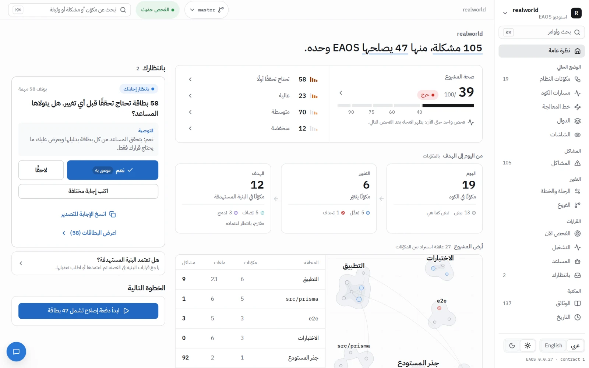
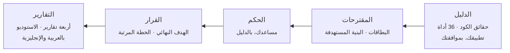
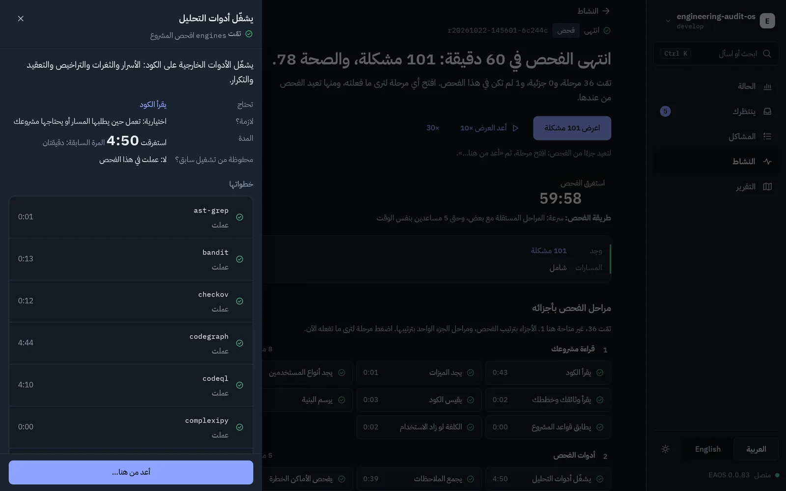
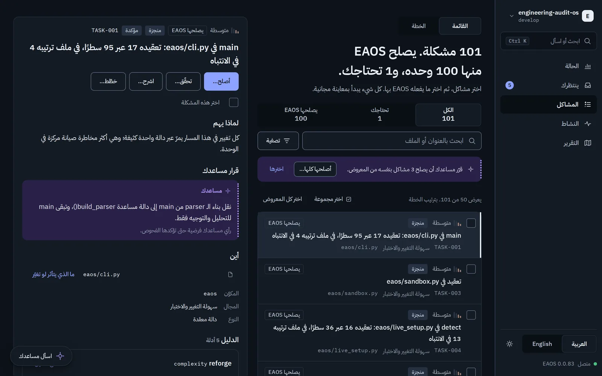
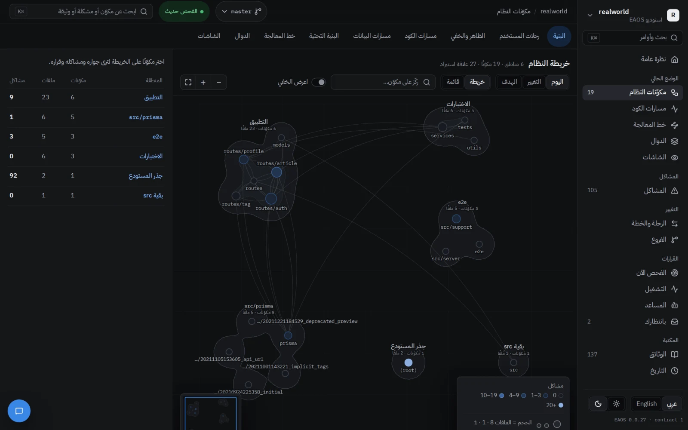
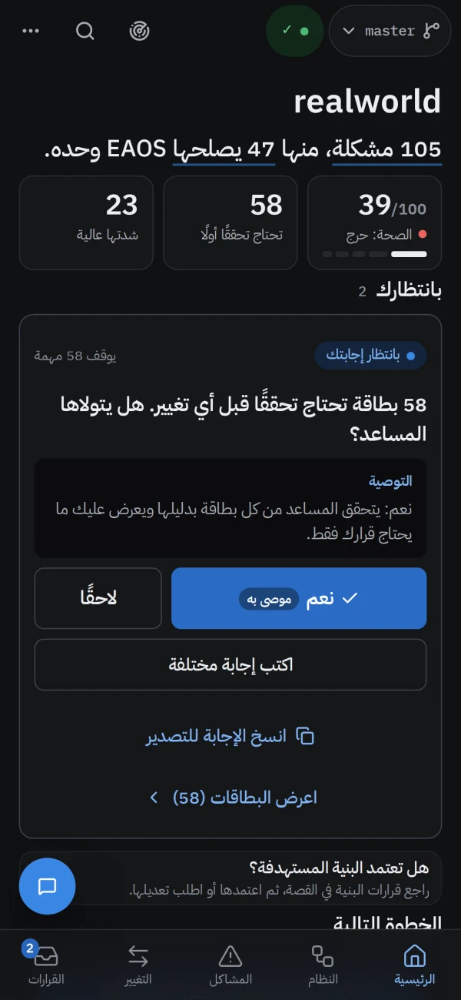
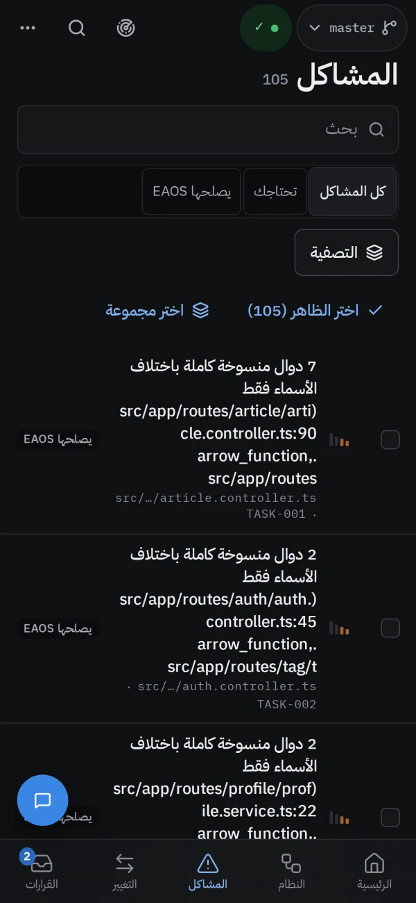
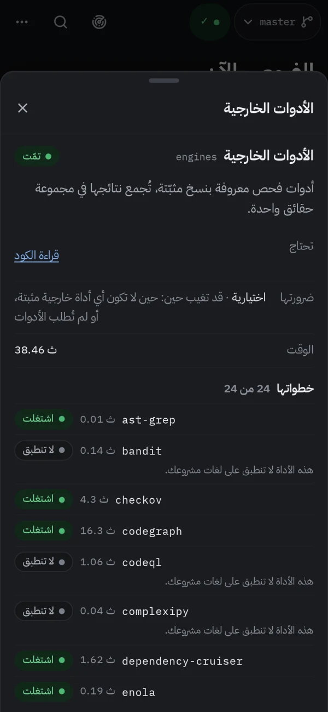

<div dir="rtl">

<p align="center">
  <picture>
    <source media="(prefers-color-scheme: dark)" srcset="docs/assets/brand/banner-dark.webp">
    
  </picture>
</p>

<p align="center">
  <b>المراجعة الهندسية التي لم يحظَ بها برنامجك المبني بالذكاء الاصطناعي.</b><br>
  دليل لكل نتيجة، والبنية التي يجب أن يصل إليها، وإصلاحات تثبت نجاحها بنفسها، في أمر واحد.
</p>

<p align="center">
  <a href="CHANGELOG.md"></a>
  
  
  <a href="LICENSE"></a>
  
</p>

<p align="center">
  <a href="README.md">English</a> · <b>العربية</b> ·
  <a href="docs/GUIDE.ar.md">الدليل</a> ·
  <a href="docs/REFERENCE.md">المرجع</a> ·
  <a href="CHANGELOG.md">سجل التغييرات</a> ·
  <a href="ROADMAP.md">خارطة الطريق</a>
</p>

<p align="center">
  <picture>
    <source media="(prefers-color-scheme: dark)" srcset="docs/assets/screens/ar/overview-dark.webp">
    
  </picture>
</p>

---

## لماذا EAOS

البرمجيات التي تُبنى بسرعة، وكثيرًا ما تُبنى بمساعد ذكي، تعمل، إلى أن لا يعرف أحد كيف بُنيت، ولا ما تلمسه، ولا ما
سيكسره أي تغيير. والمراجعة الهندسية الجادة تستغرق أسابيع من وقت كبار المهندسين، وتنتهي غالبًا برأي لا يمكن التحقق
منه، أو بخطة لا يُعرف من أين تبدأ.

يستبدل EAOS الأمرين بقاعدة واحدة: **لا نتيجة بلا دليل، ولا مهمة بلا معيار قبول، ولا تغيير أكبر مما تستحقه
المشكلة.** يقرأ مشروعك كما يقرؤه مهندس معماري ومراجع كود ومهندس أمن وقائد تقني معًا، وكل استنتاج يعود إلى الحقائق
التي قام عليها.

## ماذا يفعل

<table dir="rtl">
  <tr>
    <td width="50%" valign="top">
      <h3>🔍 يفحص</h3>
      ستة وثلاثون أداة تحليل مفتوحة المصدر بإصدارات مثبّتة، ومعها تطبيقك يعمل في نسخة معزولة، تنتج مجموعة حقائق
      واحدة: البنية، والتعقيد، والتكرار، والكود الميت، والأمان، والمكتبات، والشاشات، والسرعة. ما تتفق عليه أداتان
      يصبح بطاقة، والباقي يُحكم عليه بدليله.
    </td>
    <td width="50%" valign="top">
      <h3>🧭 يخطط</h3>
      الشكل الاحترافي الذي يجب أن يصل إليه مشروعك: كل مكوّن يُبقى أو يُعاد بناؤه أو يُدمج أو يُنشأ أو يُحذف، ومعه
      السبب. ثم خطة مرتبة من بطاقات صغيرة، لكل بطاقة دليلها، ونطاق أثرها، وأمر قبولها، وطريقة التراجع عنها.
    </td>
  </tr>
  <tr>
    <td width="50%" valign="top">
      <h3>🛠️ يصلح</h3>
      يكتب مساعدك الإصلاحات على دفعات، ويتحقق EAOS من كل تغيير: زالت المشكلة، والاختبارات والتطبيق ما زالا يعملان،
      ولم تدخل ثغرة ولا تكرار ولا كسر للطبقات. ما ينجح يصلك فرعًا جديدًا، والقرار لك.
    </td>
    <td width="50%" valign="top">
      <h3>🏗️ يبني</h3>
      ابدأ من خطة بدل الكود: وثيقة متطلبات، أو ملاحظات، أو ملف PDF أو Word، أو صور الشاشات. يرسم EAOS البنية
      والشكل وخطة البناء كاملة، ثم يبنيها بطاقة بطاقة عبر البوابات نفسها. والمشروع المفحوص يكبر بالطريقة نفسها:
      ميزة تُخطَّط على ما هو المشروع فعلًا، وتُبنى دفعةً.
    </td>
  </tr>
</table>

## البدء السريع

**1. التثبيت** (مرة واحدة)، من داخل مجلد مشروعك:

</div>

```bash
curl -fsSL https://raw.githubusercontent.com/eom1417/engineering-audit-os/main/install.sh | bash
```

<div dir="rtl">

يثبّت EAOS وأدواته بإصداراتها المثبّتة، ويضيفه إلى **Claude Code** و**Codex**، ويفتح الاستوديو.

**2. اطلب من مساعدك** بكلماتك:

> افحص مشروعي بـ EAOS وأصلح مشاكله

أو اكتب `/eaos` وحدها (في Codex: `$eaos`) لتظهر قائمة بما يناسب مشروعك الآن، والخطوة الموصى بها أولًا.

**3. تابع في الاستوديو.** كل مرحلة وهي تعمل، وكل نتيجة بدليلها، وكل قرار ينتظرك. وحين تجهز الإصلاحات تصبح فرعًا في
مشروعك: تعتمده أو ترميه.

> [!TIP]
> جديد على الطرفية أو على EAOS؟ **[الدليل](docs/GUIDE.ar.md)** خطوة بخطوة يريك ما يجب أن تراه في كل خطوة، وماذا
> تفعل إذا حدث خطأ.

## كيف يعمل الفحص

</div>



<div dir="rtl">

الفحص 35 مرحلة معلنة بترتيب ثابت: **الدليل أولًا، ثم القرار، ثم الخطة، والتقارير أخيرًا.** وبلا مساعد ذكي يعمل
بالطريقة نفسها وتقرّر القواعد وحدها. المرحلة التي لم تعمل تقول السبب، والأداة التي فشلت تُسمّى، وإذا احتاجت مرحلة
إلى إعادة **يكمل الفحص من تلك المرحلة** ويحتفظ بالباقي: لا فحص كامل جديد من أجل مرحلة واحدة.

## ماذا يستهلك الفحص

أغلب الفحص تعمله أدوات EAOS نفسها، ولا تستهلك من مساعدك شيئًا. مساعدك يعمل مراحل الحكم فقط، وهذه تُحسب من اشتراكه.
على EAOS نفسه (593 ملفًا، ونحو 7400 دالة، بـ Claude Code ونموذج Opus) أخذ الفحص كاملًا نحو ساعة من عمل النموذج،
تعادل نحو **22 دولارًا بأسعار الواجهة البرمجية**:

| المرحلة | النسبة |
|---|---|
| فرز البطاقات على أدلتها | نحو 45% |
| مراجعة الشاشات المصوّرة | نحو 18% |
| البنية المستهدفة المثالية | نحو 17% |
| التخطيط والترتيب والتجهيز وفهم معنى المشروع | نحو 15% |
| ترجمة التقارير (بأصغر نموذج، بلا تفكير) | نحو 3% |

يكبر الاستهلاك مع حجم المشروع وعدد البطاقات. **ودفعة الإصلاح تستهلك أكثر بكثير**: مساعدك يعدّل بطاقة بطاقة، ودفعة من
70 بطاقة قد تأخذ عدة ساعات. فإن كان اشتراكك بحد خمس ساعات، فابدأ الدفعة الكبيرة في نافذة جديدة. وإن انتهى الحد في
المنتصف فلا يضيع شيء: يكمل العمل من حيث توقف، بالمساعد نفسه أو بغيره.

## الاستوديو

الاستوديو واجهة EAOS في متصفحك: يأتي داخل الحزمة، ولا يحتاج إنترنت، بالعربية والإنجليزية، فاتحًا وداكنًا، على
الحاسوب والجوال.

<table dir="rtl">
  <tr>
    <td width="50%"></td>
    <td width="50%"></td>
  </tr>
  <tr>
    <td><b>الفحص الحي.</b> كل مرحلة وهي تعمل، وأدواتها، وما أنتجته، و«أعد من هنا».</td>
    <td><b>المشاكل.</b> كل بطاقة بدليلها حتى السطر، جاهزة للإصلاح في دفعة واحدة.</td>
  </tr>
  <tr>
    <td colspan="2"></td>
  </tr>
  <tr>
    <td colspan="2"><b>خريطة النظام.</b> المناطق والمكونات وروابطها: اليوم، وأثناء التغيير، وعند الهدف.</td>
  </tr>
</table>

<p align="center">
  
  
  
</p>

<p align="center"><sub>في الصور: فحص حقيقي لمشروع
<a href="https://github.com/gothinkster/node-express-realworld-example-app">RealWorld Conduit</a>، تطبيق مثال مفتوح
المصدر بـ Node.js وTypeScript (رخصة MIT).</sub></p>

## ماذا تستلم

كل شيء في مجلد واحد: `~/EAOS/<مشروعك>/`

| | |
|---|---|
| `REPORT.html` | التقرير لك، بكلمات بسيطة |
| `technical/CURRENT-STATE.md` | ما البرنامج اليوم: ميزاته، وبياناته، وبنيته، ومخاطره المقاسة |
| `technical/TARGET-STATE.md` | البرنامج نفسه على بنية تليق بمنتج |
| `technical/GAP-AND-STRATEGY.md` | المسافة بينهما، والاستراتيجية التي تغلقها |
| `technical/EXECUTION-PLAN.md` | البطاقات مرتبة، مرحلة بعد مرحلة |
| `technical/i18n/ar/` · `technical/i18n/en/` | كل وثيقة كاملةً بالعربية وبالإنجليزية |

كل بطاقة قائمة بذاتها:

</div>

```text
TASK-001  7 دوال منسوخة كاملة باختلاف الأسماء فقط
├─ الدليل        مجموعة التكرار، وأسطرها، والكود نفسه
├─ نطاق الأثر    الملفات، ومن يستوردها، والمسارات، والاختبارات التي تغطيها
├─ الخيارات      أصغر تغيير ← إعادة الهيكلة ← لا شيء، ولكل خيار كلفته
├─ القبول        أمر يعيد فحص المشكلة نفسها
└─ التراجع       كيف تعود خطوة إلى الوراء
```

<div dir="rtl">

## الثقة جزء من التصميم

يعامل EAOS مشروعك مدخلًا غير موثوق، وقراراتك نهائية.

- **كودك لا يتغير** حتى تعتمد فرعًا. الإصلاحات تُبنى في نسخة معزولة.
- **تطبيقك لا يعمل إلا بموافقتك**، في نسخة منفصلة، بلا أسرارك ولا قاعدة بياناتك الحقيقية.
- **لا شيء غير مقاس ينجح.** المرحلة التي لم تعمل، أو الأداة التي فشلت، تُذكر ولا تُقرأ على أنها سليمة.
- **لا تُحذف ميزة لإخفاء مشكلة.** الإصلاح الذي يفعل ذلك يُرفض.
- **التعليمات المكتوبة داخل مشروعك لا تُتّبع أبدًا**، فهي بيانات.

## الأدوات

ينسّق EAOS ولا يعيد البناء: 36 أداة مفتوحة المصدر ومكتبات تصميم مجانية، لكل منها إصدار مثبّت ببصمته ورخصته
([`upstreams/toolchain.json`](upstreams/toolchain.json)، [`THIRD_PARTY_NOTICES.md`](THIRD_PARTY_NOTICES.md)).

| المجال | الأدوات |
|---|---|
| البنية والفهم | CodeGraph · GitNexus · Enola · Reforge · ast-grep · dependency-cruiser · react-docgen · CodeCharta · Emerge |
| التعقيد والتكرار والكود الميت | Lizard · complexipy · jscpd · scc · vulture · knip |
| الأمان والمكتبات | Semgrep · Bandit · Gitleaks · CodeQL¹ · OSV-Scanner · Syft · Trivy · Checkov |
| العقود والبيانات | Spectral · oasdiff · SQLFluff |
| تطبيقك وهو يعمل | Playwright · rrweb · Lighthouse · axe-core · css-analyzer · pytest · k6 |
| التغييرات الآلية | jscodeshift |
| التصميم (شكل البناء أو إعادة التصميم) | UI UX Pro Max · awesome-design-md · tweakcn themes · frontend-design من Anthropic · shadcn/ui · Fontsource |

<sub>¹ يعمل CodeQL على المشاريع مفتوحة المصدر المنشورة علنًا على GitHub فقط، كما تسمح شروطه.</sub>

## التوثيق

| | |
|---|---|
| [الدليل](docs/GUIDE.ar.md) · [Guide](docs/GUIDE.md) | من لا شيء إلى أول إصلاح، خطوة بخطوة |
| [البناء من خطة](docs/BUILD-FROM-PLAN.ar.md) · [English](docs/BUILD-FROM-PLAN.md) | مشروع جديد من خطته، بأفضل بنية؛ وميزة تُضاف لمشروع مفحوص |
| [الذكاء في خط الفحص](docs/AI-IN-THE-PIPELINE.md) | أين يقرّر مساعدك، وكيف تُراجع قراراته (بالإنجليزية) |
| [أدوات MCP](docs/MCP.md) | الأدوات التي يقدمها EAOS لمساعدك (بالإنجليزية) |
| [المرجع](docs/REFERENCE.md) | كل أمر وكل خيار (بالإنجليزية) |

## المساهمة

البلاغات وطلبات الدمج مرحّب بها: اقرأ [`CONTRIBUTING.md`](CONTRIBUTING.md) أولًا. وللإبلاغ عن ثغرة اتبع
[`SECURITY.md`](SECURITY.md). وكل من يشارك يلتزم بـ[ميثاق السلوك](CODE_OF_CONDUCT.md).

## الرخصة

[MIT](LICENSE). وتحتفظ الأدوات التي يشغّلها EAOS برخصها، وهي مذكورة في [`THIRD_PARTY_NOTICES.md`](THIRD_PARTY_NOTICES.md).

<p align="center"><sub>بُني بـ EAOS، وفُحص بـ EAOS.</sub></p>

</div>
