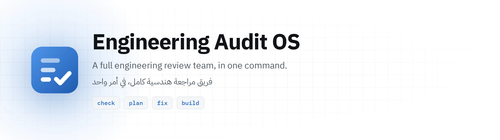
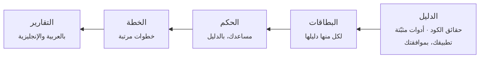

<div dir="rtl">

<p align="center">
  <picture>
    <source media="(prefers-color-scheme: dark)" srcset="docs/assets/brand/banner-dark.webp">
    
  </picture>
</p>

<p align="center">
  <b>المراجعة الهندسية التي لم يحظَ بها برنامجك المبني بالذكاء الاصطناعي.</b><br>
  دليل لكل نتيجة، وخطة مرتبة، وإصلاحات تثبت نجاحها بنفسها، في أمر واحد.
</p>

<p align="center">
  <a href="CHANGELOG.md"></a>
  
  
  <a href="LICENSE"></a>
  
</p>

<p align="center">
  <a href="README.md">English</a> · <b>العربية</b> ·
  <a href="docs/GUIDE.ar.md">الدليل</a> ·
  <a href="docs/REFERENCE.md">المرجع</a> ·
  <a href="CHANGELOG.md">سجل التغييرات</a> ·
  <a href="ROADMAP.md">خارطة الطريق</a>
</p>

---

> **التوجه (نوفمبر 2026):** يُعاد تركيز EAOS على هدف واحد: إدارة جولة تنظيف هيكلية كاملة على مشروع بناه مبتدئ أو بُني
> بالبرمجة بالإحساس، مع إثبات أن السلوك لم يتغير، حتى يصير منتجًا نظيفًا قابلًا للطرح
> ([نجم الشمال](docs/NORTH-STAR.ar.md)، [خريطة الطريق](ROADMAP.md)). وما تصفه هذه الصفحة هو ما يفعله EAOS اليوم.

## لماذا EAOS

البرمجيات التي تُبنى بسرعة، وكثيرًا ما تُبنى بمساعد ذكي، تعمل، إلى أن لا يعرف أحد كيف بُنيت، ولا ما تلمسه، ولا ما
سيكسره أي تغيير. والمراجعة الهندسية الجادة تستغرق أسابيع من وقت كبار المهندسين، وتنتهي غالبًا برأي لا يمكن التحقق
منه، أو بخطة لا يُعرف من أين تبدأ.

EAOS شركة هندسة برمجيات كاملة في أمر واحد. الأدوات مفتوحة المصدر بإصداراتها المثبّتة هي مهندسوها المتخصصون، ومساعدك
الذكي نفسه (Claude Code أو Codex) هو كبير مهندسيها. وتحكمه قاعدة واحدة من أوله إلى آخره: **لا نتيجة بلا دليل، ولا
مهمة بلا معيار قبول، ولا تغيير أكبر مما تستحقه المشكلة.**

## ماذا يفعل

<table dir="rtl">
  <tr>
    <td width="50%" valign="top">
      <h3>🔍 يفحص</h3>
      نحو عشرين أداة مفتوحة المصدر بإصدارات مثبّتة، ومعها أدوات EAOS الخاصة، وتطبيقك يعمل في نسخة معزولة إن وافقت،
      تنتج مجموعة حقائق واحدة: البنية، والتعقيد، والتكرار، والكود الميت، والأمان، والشاشات. ويُقرأ النظام طبقاتٍ: ما
      يصل إلى المتصفح، وحماية كل نقطة طلب، وقواعد قاعدة البيانات، ومكان قواعد العمل، والاختبارات. وكل نتيجة تصبح
      بطاقة بدليلها، ويحكم فيها مساعدك.
    </td>
    <td width="50%" valign="top">
      <h3>🛠️ يصلح</h3>
      خطة مرتبة من بطاقات صغيرة، لكل بطاقة دليلها، ونطاق أثرها، وأمر قبولها، وطريقة التراجع عنها. يكتب مساعدك
      الإصلاحات على دفعات، ويتحقق EAOS من كل تغيير: زالت المشكلة، والاختبارات والشاشات وكلماتها ما زالت سليمة، ولم
      تدخل ثغرة ولا تكرار ولا كسر للطبقات. ما ينجح يصلك فرعًا جديدًا، والقرار لك.
    </td>
  </tr>
</table>

## البدء السريع

**1. التثبيت** (مرة واحدة)، من داخل مجلد مشروعك:

</div>

```bash
curl -fsSL https://raw.githubusercontent.com/eom1417/engineering-audit-os/main/install.sh | bash
```

<div dir="rtl">

يثبّت EAOS وأدواته بإصداراتها المثبّتة، ويضيفه إلى **Claude Code** و**Codex**.

**2. اطلب من مساعدك** بكلماتك:

> افحص مشروعي بـ EAOS وأصلح مشاكله

أو اكتب `/eaos` وحدها (في Codex: `$eaos`) لتظهر قائمة بما يناسب مشروعك الآن، والخطوة الموصى بها أولًا.

**3. قرّر.** يشرح لك مساعدك ما وجده الفحص بدليله، ولا يسألك إلا عمّا هو قرارك. وحين تجهز الإصلاحات تصبح فرعًا في
مشروعك: تعتمده أو ترميه.

> [!TIP]
> جديد على الطرفية أو على EAOS؟ **[الدليل](docs/GUIDE.ar.md)** خطوة بخطوة يريك ما يجب أن تراه في كل خطوة، وماذا
> تفعل إذا حدث خطأ.

## الأوامر في لمحة

كل ما يفعله مساعدك مع EAOS (MCP) متاح كذلك من الطرفية. وهذه الأوامر القليلة التي يحتاجها أغلب الناس:

</div>

```bash
eaos start                                # افحص هذا المشروع (يسأل مرة عن المساعد وعن تشغيل تطبيقك)
eaos check --path security code           # افحص مسارات بعينها فقط (انظر أدناه)
eaos status                               # أين يقف المشروع؛ و`eaos next` يقول الخطوة التالية
eaos problems --severity high             # البطاقات، مصفّاة؛ و`eaos problem <id>` يعرض واحدة كاملة
eaos fix --group area=security            # أصلح دفعة في نسخة معزولة، بعد معاينة؛ أو `eaos fix <id> <id>`
eaos accept                               # اعتمد فرع الإصلاحات المنتظر؛ و`eaos undo` يرميه
```

<div dir="rtl">

كل أمر وكل خيار: [`docs/REFERENCE.md`](docs/REFERENCE.md)، أو `eaos <command> --help`.

## كيف يعمل الفحص

</div>



<div dir="rtl">

الفحص 27 مرحلة معلنة بترتيب ثابت: **الدليل أولًا، ثم البطاقات والحكم فيها، ثم الخطة، والتقارير أخيرًا.** وبلا
مساعد ذكي (`--assistant none`) يعمل بالطريقة نفسها وتقرّر القواعد وحدها. المرحلة التي لم تعمل تقول السبب، والأداة
التي فشلت تُسمّى، و`--again-from` يكمل من مرحلة واحدة ويحتفظ بالباقي.

**مسارات الفحص.** الفحص الشامل هو الافتراضي، و`--path` يختار مسارًا أو أكثر:

| المسار | ما ينظر فيه |
|---|---|
| `complete` | كل المسارات معًا: الفحص كاملًا |
| `code` | البنية والطبقات، والتشابك، والتعقيد، والتكرار، والكود الميت، والاختبارات |
| `security` | الأسرار المكشوفة، والكود المعرّض للثغرات، والبيانات الحقيقية المكتوبة في الكود، وحدود الطبقات |
| `look` | شاشات التطبيق، وسهولة استخدامها وسرعتها، ورحلات المستخدمين |
| `speed` | العمل الذي يكرره الكود بلا داعٍ (نداء يتكرر، أو استعلام داخل حلقة) |

**مستويات النماذج.** كل مرحلة ذكية تسأل على المستوى الذي تحتاجه: الفرز الأول للبطاقة والترجمة على المستوى الخفيف
(haiku في Claude Code، والجهد المنخفض في Codex)، وترتيب الخطة على المستوى المتوسط (sonnet، والجهد المتوسط)،
ومراجعة الإصلاح وكل خطوة ذكية غيرها على المستوى العميق (نموذجك أنت، والجهد العالي في Codex). **ولا يحسم نموذج أرخص
شيئًا وحده:** استبعاد بطاقة يُسأل عنه مرة أخرى على المستوى العميق. و`--mode speed` يشغّل عدة مساعدين معًا وينزل
بالمراحل المتوسطة إلى الخفيف.

## ماذا يستهلك الفحص

أغلب الفحص تعمله أدوات EAOS نفسها، ولا تستهلك من مساعدك شيئًا. أما مراحل الحكم فتسأل مساعدك: في الاشتراك تُحسب من
باقتك، وبمفتاح الواجهة البرمجية تكلّف مالًا، و`eaos usage` يعرض ما صُرف. قيس بـ Claude Code
([`docs/METRICS.md`](docs/METRICS.md))، والدولارات هي الكلفة التي يذكرها المساعد لطلباته:

| التشغيل (على 0.0.83، وكان يشغّل مراحل أكثر مما يشغّله الفحص الآن) | الوقت | الكلفة |
|---|---|---|
| فحص شامل لتطبيق Flask صغير | 738 ث | 1.02$ |
| بطاقة منه أُصلحت وسُلّمت فرعًا | 118 ث | 0.36$ |

تكبر الكلفة مع حجم المشروع، وعدد البطاقات، وحجم دفعة الإصلاح. وإن انتهى حد الاستخدام في المنتصف فلا يضيع شيء: يكمل
العمل من حيث توقف، بالمساعد نفسه أو بغيره.

## ماذا تستلم

كل شيء في مجلد واحد: `~/EAOS/<مشروعك>/`

| | |
|---|---|
| `technical/START-HERE.md` | الصفحة الأولى: ما وُجد، وما يصلحه EAOS وحده |
| `technical/CURRENT-STATE.md` | ما البرنامج اليوم: ميزاته، وبياناته، ومخاطره المقاسة |
| `technical/TARGET-STATE.md` | الميزات نفسها على بنية تليق بمنتج، مع بنيتها التحتية |
| `technical/GAP-AND-STRATEGY.md` | المسافة، مكوّنًا مكوّنًا، وترتيب إغلاقها |
| `technical/EXECUTION-PLAN.md` | المراحل، والأقسام، وأول البطاقات التي يبدأ بها الفريق |
| `technical/PLAN/` | كل بطاقة في ملف، وترتيب الخطة |
| `technical/i18n/ar/` · `technical/i18n/en/` | كل وثيقة كاملةً بالعربية وبالإنجليزية |
| `fixes/` · `HANDOVER.md` | كل دفعة إصلاحات وفرعها · أين توقف العمل، للمساعد التالي |

كل بطاقة قائمة بذاتها:

</div>

```text
TASK-001  7 دوال منسوخة كاملة باختلاف الأسماء فقط
├─ الدليل        مجموعة التكرار، وأسطرها، والكود نفسه
├─ نطاق الأثر    الملفات، ومن يستوردها، والمسارات، والاختبارات التي تغطيها
├─ الخيارات      أصغر تغيير ← إعادة الهيكلة ← لا شيء، ولكل خيار كلفته
├─ القبول        أمر يعيد فحص المشكلة نفسها
└─ التراجع       كيف تعود خطوة إلى الوراء
```

<div dir="rtl">

## الثقة جزء من التصميم

يعامل EAOS مشروعك مدخلًا غير موثوق، وقراراتك نهائية.

- **كودك لا يتغير** حتى تعتمد فرعًا. الإصلاحات تُبنى في نسخة معزولة.
- **تطبيقك لا يعمل إلا بموافقتك**، في نسخة منفصلة على هذا الحاسوب، بلا أسرارك ولا قاعدة بياناتك الحقيقية.
- **لا شيء غير مقاس ينجح.** المرحلة التي لم تعمل، أو الأداة التي فشلت، تُذكر ولا تُقرأ على أنها سليمة.
- **لا تُحذف ميزة لإخفاء مشكلة.** الإصلاح الذي يفعل ذلك يُرفض.
- **التعليمات المكتوبة داخل مشروعك، أو التي يعرضها تطبيقك، لا تُتّبع أبدًا**، فهي بيانات.

## الأدوات

ينسّق EAOS ولا يعيد البناء: نحو عشرين أداة مفتوحة المصدر، لكل منها إصدار مثبّت ببصمته ورخصته
([`eaos/data/toolchain.json`](eaos/data/toolchain.json)، [`THIRD_PARTY_NOTICES.md`](THIRD_PARTY_NOTICES.md)).

| المجال | الأدوات |
|---|---|
| البنية والفهم | ast-grep · dependency-cruiser، مع خريطة EAOS الخاصة لروابط الكود |
| التعقيد والتكرار والكود الميت | Lizard · jscpd · knip، مع عدّ EAOS الخاص |
| الأمان | Semgrep وقواعده · Gitleaks · Presidio (البيانات الحقيقية المكتوبة في الكود) |
| تطبيقك وهو يعمل | Playwright · rrweb · Lighthouse · axe-core · pytest · Mailpit (يلتقط بريد التطبيق) |
| التغييرات الآلية | jscodeshift، مع أداة النقل الخاصة بـ EAOS |

## التوثيق

| | |
|---|---|
| [الدليل](docs/GUIDE.ar.md) · [Guide](docs/GUIDE.md) | من لا شيء إلى أول إصلاح، خطوة بخطوة |
| [نجم الشمال](docs/NORTH-STAR.ar.md) · [English](docs/NORTH-STAR.md) | لماذا وُجد EAOS، والمبادئ التي لا يكسرها أبدًا |
| [الذكاء في خط الفحص](docs/AI-IN-THE-PIPELINE.md) | أين يقرّر مساعدك، وكيف تُراجع قراراته (بالإنجليزية) |
| [أدوات MCP](docs/MCP.md) | الأدوات التي يقدمها EAOS لمساعدك (بالإنجليزية) |
| [المرجع](docs/REFERENCE.md) | كل أمر وكل خيار (بالإنجليزية) |

## المساهمة

البلاغات وطلبات الدمج مرحّب بها: اقرأ [`CONTRIBUTING.md`](CONTRIBUTING.md) أولًا. وللإبلاغ عن ثغرة اتبع
[`SECURITY.md`](SECURITY.md). وكل من يشارك يلتزم بـ[ميثاق السلوك](CODE_OF_CONDUCT.md). ولإعداد نسخة للتطوير:
`bash tools/dev_setup.sh` يبني البيئة ويثبّت كل أداة بإصدارها المثبّت.

## الرخصة

[MIT](LICENSE). وتحتفظ الأدوات التي يشغّلها EAOS برخصها، وهي مذكورة في [`THIRD_PARTY_NOTICES.md`](THIRD_PARTY_NOTICES.md).

<p align="center"><sub>بُني بـ EAOS، وفُحص بـ EAOS.</sub></p>

</div>
