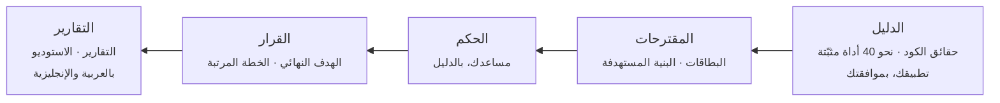

<div dir="rtl">

<p align="center">
  <picture>
    <source media="(prefers-color-scheme: dark)" srcset="docs/assets/brand/banner-dark.webp">
    
  </picture>
</p>

<p align="center">
  <b>المراجعة الهندسية التي لم يحظَ بها برنامجك المبني بالذكاء الاصطناعي.</b><br>
  دليل لكل نتيجة، والبنية التي يجب أن يصل إليها، وإصلاحات تثبت نجاحها بنفسها، في أمر واحد.
</p>

<p align="center">
  <a href="CHANGELOG.md"></a>
  
  
  <a href="LICENSE"></a>
  
</p>

<p align="center">
  <a href="README.md">English</a> · <b>العربية</b> ·
  <a href="docs/GUIDE.ar.md">الدليل</a> ·
  <a href="docs/REFERENCE.md">المرجع</a> ·
  <a href="CHANGELOG.md">سجل التغييرات</a> ·
  <a href="ROADMAP.md">خارطة الطريق</a>
</p>

<p align="center">
  <picture>
    <source media="(prefers-color-scheme: dark)" srcset="docs/assets/screens/ar/overview-dark.webp">
    
  </picture>
</p>

---

## لماذا EAOS

البرمجيات التي تُبنى بسرعة، وكثيرًا ما تُبنى بمساعد ذكي، تعمل، إلى أن لا يعرف أحد كيف بُنيت، ولا ما تلمسه، ولا ما
سيكسره أي تغيير. والمراجعة الهندسية الجادة تستغرق أسابيع من وقت كبار المهندسين، وتنتهي غالبًا برأي لا يمكن التحقق
منه، أو بخطة لا يُعرف من أين تبدأ.

EAOS شركة هندسة برمجيات كاملة في أمر واحد. الأدوات مفتوحة المصدر بإصداراتها المثبّتة هي مهندسوها المتخصصون، ومساعدك
الذكي نفسه (Claude Code أو Codex) هو كبير مهندسيها. وتحكمه قاعدة واحدة من أوله إلى آخره: **لا نتيجة بلا دليل، ولا
مهمة بلا معيار قبول، ولا تغيير أكبر مما تستحقه المشكلة.**

## ماذا يفعل

<table dir="rtl">
  <tr>
    <td width="50%" valign="top">
      <h3>🔍 يفحص</h3>
      نحو أربعين أداة مفتوحة المصدر بإصدارات مثبّتة، ومعها تطبيقك يعمل في نسخة معزولة، تنتج مجموعة حقائق واحدة:
      البنية، والتعقيد، والتكرار، والكود الميت، والأمان، والمكتبات، والشاشات، والسرعة. ويُقرأ النظام طبقاتٍ: ما يصل
      إلى المتصفح، وحماية كل نقطة طلب، وقواعد قاعدة البيانات، ومكان قواعد العمل، والاختبارات. ما تتفق عليه أداتان
      يصبح بطاقة، والباقي يُحكم عليه بدليله.
    </td>
    <td width="50%" valign="top">
      <h3>👥 يجرّبه كما يجرّبه مستخدموه</h3>
      مستخدمون محاكَون، لكل منهم دور وهدف، يستعملون تطبيقك وهو يعمل في نسخة معزولة: يسعون إلى أهدافهم، ويسلّم بعضهم
      العمل لبعض، ويكتبون إلى الدعم الفني. وكل صعوبة يلقاها مستخدم جديد مرة أخرى، ويحكم فيها حَكَم صارم؛ والصعوبة
      المؤكدة تصبح بطاقة إصلاح بخطوات إعادة إنتاجها وصورها.
    </td>
  </tr>
  <tr>
    <td width="50%" valign="top">
      <h3>🧭 يخطط</h3>
      الشكل الاحترافي الذي يجب أن يصل إليه مشروعك: كل مكوّن يُبقى أو يُعاد بناؤه أو يُدمج أو يُنشأ أو يُحذف، ومعه
      السبب، والقرار بين الإصلاح وإعادة البناء. ثم خطة مرتبة من بطاقات صغيرة، لكل بطاقة دليلها، ونطاق أثرها، وأمر
      قبولها، وطريقة التراجع عنها.
    </td>
    <td width="50%" valign="top">
      <h3>🛠️ يصلح</h3>
      يكتب مساعدك الإصلاحات على دفعات، ويتحقق EAOS من كل تغيير: زالت المشكلة، والاختبارات والشاشات وكلماتها ما زالت
      سليمة، ولم تدخل ثغرة ولا تكرار ولا كسر للطبقات. ما ينجح يصلك فرعًا جديدًا، والقرار لك.
    </td>
  </tr>
</table>

## ثلاث رحلات

| الرحلة | تبدأ بـ | تنتهي بـ |
|---|---|---|
| **الإصلاح** | مشروع يعمل في ظاهره | فحص، وبنية مستهدفة، وخطة، وإصلاحات في فروع تعتمدها أو ترميها |
| **البناء من خطة** | وثيقة متطلبات، أو ملاحظات، أو ملف PDF أو Word، أو صور الشاشات | مشروع يُبنى بطاقة بطاقة عبر البوابات نفسها، مرتبًا من يومه الأول ([كيف](docs/BUILD-FROM-PLAN.ar.md)) |
| **إضافة ميزة** | مشروع مفحوص، وميزة تصفها بكلماتك | ميزة تُخطَّط على ما هو المشروع فعلًا، وتُبنى دفعةً واحدة دون أن تكسر ما هو موجود |

الرحلات الثلاث مثبتة من أولها إلى آخرها بمساعد حقيقي على هذا الإصدار ([`docs/METRICS.md`](docs/METRICS.md)).

## البدء السريع

**1. التثبيت** (مرة واحدة)، من داخل مجلد مشروعك:

</div>

```bash
curl -fsSL https://raw.githubusercontent.com/eom1417/engineering-audit-os/main/install.sh | bash
```

<div dir="rtl">

يثبّت EAOS وأدواته بإصداراتها المثبّتة، ويضيفه إلى **Claude Code** و**Codex**، ويفتح الاستوديو.

**2. اطلب من مساعدك** بكلماتك:

> افحص مشروعي بـ EAOS وأصلح مشاكله

أو اكتب `/eaos` وحدها (في Codex: `$eaos`) لتظهر قائمة بما يناسب مشروعك الآن، والخطوة الموصى بها أولًا.

**3. تابع في الاستوديو.** كل مرحلة وهي تعمل، وكل نتيجة بدليلها، وكل قرار ينتظرك. وحين تجهز الإصلاحات تصبح فرعًا في
مشروعك: تعتمده أو ترميه.

> [!TIP]
> جديد على الطرفية أو على EAOS؟ **[الدليل](docs/GUIDE.ar.md)** خطوة بخطوة يريك ما يجب أن تراه في كل خطوة، وماذا
> تفعل إذا حدث خطأ.

## الأوامر في لمحة

كل ما يفعله الاستوديو متاح كذلك من الطرفية ومن مساعدك (MCP). وهذه الأوامر القليلة التي يحتاجها أغلب الناس:

</div>

```bash
eaos start                                # افحص هذا المشروع (يسأل مرة عن المساعد وعن تشغيل تطبيقك)
eaos check --path security code           # افحص مسارات بعينها فقط (انظر أدناه)
eaos check --path complete experience     # الفحص الشامل، ومعه مستخدم محاكى واحد يؤدي المهمة الرئيسية
eaos status                               # أين يقف المشروع؛ و`eaos next` يقول الخطوة التالية
eaos problems --severity high             # البطاقات، مصفّاة كما في الاستوديو؛ و`eaos problem <id>` يعرض واحدة كاملة
eaos fix --group area=security            # أصلح دفعة في نسخة معزولة، بعد معاينة؛ أو `eaos fix <id> <id>`
eaos accept                               # اعتمد فرع الإصلاحات المنتظر؛ و`eaos undo` يرميه
eaos studio                               # افتح استوديو هذا المشروع
```

<div dir="rtl">

كل أمر وكل خيار: [`docs/REFERENCE.md`](docs/REFERENCE.md)، أو `eaos <command> --help`.

## كيف يعمل الفحص

</div>



<div dir="rtl">

الفحص 40 مرحلة معلنة بترتيب ثابت: **الدليل أولًا، ثم القرار، ثم الخطة، والتقارير أخيرًا.** وبلا مساعد ذكي
(`--assistant none`) يعمل بالطريقة نفسها وتقرّر القواعد وحدها. المرحلة التي لم تعمل تقول السبب، والأداة التي فشلت
تُسمّى، و`--again-from` يكمل من مرحلة واحدة ويحتفظ بالباقي.

**مسارات الفحص.** الفحص الشامل هو الافتراضي، و`--path` يختار مسارًا أو أكثر:

| المسار | ما ينظر فيه |
|---|---|
| `complete` | كل المسارات معًا: الفحص كاملًا |
| `code` | البنية والطبقات، والتشابك، والتعقيد، والتكرار، والكود الميت، والاختبارات، وسهولة التوسع |
| `security` | الأسرار المكشوفة، والثغرات، والمكتبات وتراخيصها، والإعدادات الخطرة، وثغرات الصلاحيات |
| `look` | شاشات التطبيق، وسهولة استخدامها وسرعتها، ومراجعة التصميم، ورحلات المستخدمين |
| `speed` | التطبيق تحت الضغط، وكلفة كل نقطة دخول لو زاد الاستخدام ألف مرة، والمسارات الساخنة، والجاهزية للتشغيل الفعلي |
| `layers` | الحدود مجرَّبة على نسخة معزولة: الأسرار في البناء النهائي، وقواعد البيانات كمستخدمين مختلفين، ونقاط الطلب بحسابين تجريبيين. يضيف حتى 15 دقيقة |
| `experience` | مستخدمون محاكَون. وحده: عدة أشخاص ببياناتهم وتسليماتهم ودعم فني، حتى ساعة. مع `complete`: شخص واحد يؤدي المهمة الرئيسية، حتى 5 دقائق و12 طلبًا خفيفًا. مطفأ إلا إذا اخترته. والرحلات التي حفظها تُعاد بلا ذكاء اصطناعي في كل فحص كامل |

**مستويات النماذج.** كل مرحلة ذكية تسأل على المستوى الذي تحتاجه: الفرز الأول للبطاقة والترجمة على المستوى الخفيف
(haiku في Claude Code، والجهد المنخفض في Codex)، وترتيب الخطة ومراجعة الشاشات على المستوى المتوسط (sonnet، والجهد
المتوسط)، والبنية المستهدفة ومراجعة الإصلاح وكل حَكَم على المستوى العميق (نموذجك أنت، والجهد العالي في Codex). **ولا
يحسم نموذج أرخص شيئًا وحده:** استبعاد بطاقة، أو الحكم بأن فجوة ليست فجوة أو أن شاشة سليمة، يُسأل عنه مرة أخرى على
المستوى العميق. و`--mode speed` يشغّل عدة مساعدين معًا وينزل بالمراحل المتوسطة إلى الخفيف.

**البحث عن ثغرات المنطق.** فحص عميق اختياري بعد الفحص، `eaos logic-flaws <project> --out <report folder>`: يقرأ
مساعدك كل مسار عمل بحثًا عن الثغرات التي لا تسمّيها قاعدة (خطوة تُتخطّى، أو سباق بين طلبين، أو كمية سالبة، أو تحقق
في غير موضعه). يقول وقته وكلفته قبل أن يبدأ، وكل ثغرة يجب أن تستند إلى سطر حقيقي، وأن تصمد أمام ناقد، ثم تُفرز
كأي بطاقة.

## ماذا يستهلك الفحص

أغلب الفحص تعمله أدوات EAOS نفسها، ولا تستهلك من مساعدك شيئًا. أما مراحل الحكم فتسأل مساعدك: في الاشتراك تُحسب من
باقتك، وبمفتاح الواجهة البرمجية تكلّف مالًا، و`eaos usage` يعرض ما صُرف. قيس بـ Claude Code
([`docs/METRICS.md`](docs/METRICS.md))، والدولارات هي الكلفة التي يذكرها المساعد لطلباته:

| التشغيل (على 0.0.83 ما لم يُذكر غيره) | الوقت | الكلفة |
|---|---|---|
| فحص شامل لتطبيق Flask صغير | 738 ث | 1.02$ |
| بطاقة منه أُصلحت وسُلّمت فرعًا | 118 ث | 0.36$ |
| ميزة أُضيفت إليه: رابط في شريط التنقل الذي تعرضه كل صفحة | 120 ث | 0.43$ |
| مشروع جديد بُني من وثيقة متطلبات حتى بوابة إثبات مرحلته الأولى | 338 ث | 0.91$ |
| مستخدمون محاكَون على تطبيق بتسجيل دخول، المحاكاة كاملة (142 طلبًا للمساعد) | — | 6.37$ |
| فحص كامل لمستودع EAOS نفسه، مع تشغيل تطبيقه (على 0.0.81) | 3,474 ث | 9.09$ |

تكبر الكلفة مع حجم المشروع، وعدد البطاقات، وحجم دفعة الإصلاح. وإن انتهى حد الاستخدام في المنتصف فلا يضيع شيء: يكمل
العمل من حيث توقف، بالمساعد نفسه أو بغيره.

## الاستوديو

الاستوديو واجهة EAOS في متصفحك: يأتي داخل الحزمة، ويعمل على هذا الحاسوب وحده، ولا يحتاج إنترنت، بالعربية
والإنجليزية، فاتحًا وداكنًا، على الحاسوب والجوال.

<table dir="rtl">
  <tr>
    <td width="50%"></td>
    <td width="50%"></td>
  </tr>
  <tr>
    <td><b>الفحص الحي.</b> كل مرحلة وهي تعمل، وأدواتها، وما أنتجته، و«أعد من هنا».</td>
    <td><b>المشاكل.</b> كل بطاقة بدليلها ومكانها، لتُصلَح أو يُتحقق منها أو تُشرح أو يُخطط لها، وحدها أو في دفعة.</td>
  </tr>
  <tr>
    <td colspan="2"></td>
  </tr>
  <tr>
    <td colspan="2"><b>التقرير.</b> البنية اليوم والهدف الذي تبلغه، والنظام في طبقات، والخطة وتقدمها، وتجربة المستخدمين.</td>
  </tr>
</table>

<p align="center">
  
  
  
</p>

<p align="center"><sub>في الصور: فحص حقيقي لمستودع EAOS نفسه، أجراه EAOS بنفسه.</sub></p>

## ماذا تستلم

كل شيء في مجلد واحد: `~/EAOS/<مشروعك>/`

| | |
|---|---|
| `REPORT.html` | التقرير لك، بكلمات بسيطة: الملخص، والفجوات والمخاطر، والبنية، والخطة والتقدم |
| `technical/START-HERE.md` | الصفحة الأولى: ما وُجد، وما يصلحه EAOS وحده |
| `technical/CURRENT-STATE.md` | ما البرنامج اليوم: ميزاته، وبياناته، ومخاطره المقاسة |
| `technical/TARGET-STATE.md` | الميزات نفسها على بنية تليق بمنتج، مع بنيتها التحتية |
| `technical/GAP-AND-STRATEGY.md` | المسافة، مكوّنًا مكوّنًا، وترتيب إغلاقها |
| `technical/EXECUTION-PLAN.md` | المراحل، والأقسام، وأول البطاقات التي يبدأ بها الفريق |
| `technical/TARGET-ARCHITECTURE.md` | البنية التي يدعمها الدليل، ومن قرّر كل جزء منها |
| `technical/PLAN/` | كل بطاقة في ملف، وترتيب الخطة |
| `technical/EXPERIENCE.md` | حين يُحاكى المستخدمون: من جرّب التطبيق، وما بلغه كل منهم، والصعوبات المؤكدة |
| `technical/i18n/ar/` · `technical/i18n/en/` | كل وثيقة كاملةً بالعربية وبالإنجليزية |
| `fixes/` · `HANDOVER.md` | كل دفعة إصلاحات وفرعها · أين توقف العمل، للمساعد التالي |

كل بطاقة قائمة بذاتها:

</div>

```text
TASK-001  7 دوال منسوخة كاملة باختلاف الأسماء فقط
├─ الدليل        مجموعة التكرار، وأسطرها، والكود نفسه
├─ نطاق الأثر    الملفات، ومن يستوردها، والمسارات، والاختبارات التي تغطيها
├─ الخيارات      أصغر تغيير ← إعادة الهيكلة ← لا شيء، ولكل خيار كلفته
├─ القبول        أمر يعيد فحص المشكلة نفسها
└─ التراجع       كيف تعود خطوة إلى الوراء
```

<div dir="rtl">

## الثقة جزء من التصميم

يعامل EAOS مشروعك مدخلًا غير موثوق، وقراراتك نهائية.

- **كودك لا يتغير** حتى تعتمد فرعًا. الإصلاحات تُبنى في نسخة معزولة.
- **تطبيقك لا يعمل إلا بموافقتك**، في نسخة منفصلة على هذا الحاسوب، بلا أسرارك ولا قاعدة بياناتك الحقيقية.
  والمستخدمون المحاكَون لا يستعملون إلا تلك النسخة.
- **لا شيء غير مقاس ينجح.** المرحلة التي لم تعمل، أو الأداة التي فشلت، تُذكر ولا تُقرأ على أنها سليمة.
- **لا تُحذف ميزة لإخفاء مشكلة.** الإصلاح الذي يفعل ذلك يُرفض.
- **التعليمات المكتوبة داخل مشروعك، أو التي يعرضها تطبيقك، لا تُتّبع أبدًا**، فهي بيانات.

## الأدوات

ينسّق EAOS ولا يعيد البناء: نحو أربعين أداة مفتوحة المصدر ومكتبة تصميم مجانية، لكل منها إصدار مثبّت ببصمته ورخصته
([`eaos/data/toolchain.json`](eaos/data/toolchain.json)، [`THIRD_PARTY_NOTICES.md`](THIRD_PARTY_NOTICES.md)).

| المجال | الأدوات |
|---|---|
| البنية والفهم | CodeGraph · GitNexus · Enola · Reforge · ast-grep · dependency-cruiser · react-docgen · CodeCharta · Emerge |
| التعقيد والتكرار والكود الميت | Lizard · jscpd · scc · knip، مع عدّ EAOS الخاص |
| الأمان والمكتبات | Semgrep وقواعده · Bandit · Gitleaks · CodeQL¹ · OSV-Scanner · Syft · Trivy · Checkov |
| العقود والبيانات | Spectral · oasdiff · SQLFluff · Schemathesis · مستشارو Supabase CLI · pgTAP |
| تطبيقك وهو يعمل | Playwright · rrweb · Lighthouse · axe-core · css-analyzer · pytest · k6 · Mailpit (يلتقط بريد التطبيق) |
| التغييرات الآلية | jscodeshift، مع أداة النقل الخاصة بـ EAOS |
| التصميم (شكل البناء أو إعادة التصميم) | UI UX Pro Max · awesome-design-md · tweakcn themes · frontend-design من Anthropic؛ ويأخذ التطبيق المبني shadcn/ui وFontsource |

<sub>¹ يعمل CodeQL على المشاريع مفتوحة المصدر المنشورة علنًا على GitHub فقط، كما تسمح شروطه. وبيئة Java مثبّتة
(Temurin) تشغّل الأدوات التي تحتاجها.</sub>

## التوثيق

| | |
|---|---|
| [الدليل](docs/GUIDE.ar.md) · [Guide](docs/GUIDE.md) | من لا شيء إلى أول إصلاح، خطوة بخطوة |
| [البناء من خطة](docs/BUILD-FROM-PLAN.ar.md) · [English](docs/BUILD-FROM-PLAN.md) | مشروع جديد من خطته، بأفضل بنية؛ وميزة تُضاف لمشروع مفحوص |
| [نجم الشمال](docs/NORTH-STAR.ar.md) · [English](docs/NORTH-STAR.md) | لماذا وُجد EAOS، والمبادئ التي لا يكسرها أبدًا |
| [الذكاء في خط الفحص](docs/AI-IN-THE-PIPELINE.md) | أين يقرّر مساعدك، وكيف تُراجع قراراته (بالإنجليزية) |
| [أدوات MCP](docs/MCP.md) | الأدوات التي يقدمها EAOS لمساعدك (بالإنجليزية) |
| [المرجع](docs/REFERENCE.md) | كل أمر وكل خيار (بالإنجليزية) |

## المساهمة

البلاغات وطلبات الدمج مرحّب بها: اقرأ [`CONTRIBUTING.md`](CONTRIBUTING.md) أولًا. وللإبلاغ عن ثغرة اتبع
[`SECURITY.md`](SECURITY.md). وكل من يشارك يلتزم بـ[ميثاق السلوك](CODE_OF_CONDUCT.md). ولإعداد نسخة للتطوير:
`bash tools/dev_setup.sh` يبني البيئة ويثبّت كل أداة بإصدارها المثبّت.

## الرخصة

[MIT](LICENSE). وتحتفظ الأدوات التي يشغّلها EAOS برخصها، وهي مذكورة في [`THIRD_PARTY_NOTICES.md`](THIRD_PARTY_NOTICES.md).

<p align="center"><sub>بُني بـ EAOS، وفُحص بـ EAOS.</sub></p>

</div>
