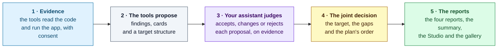
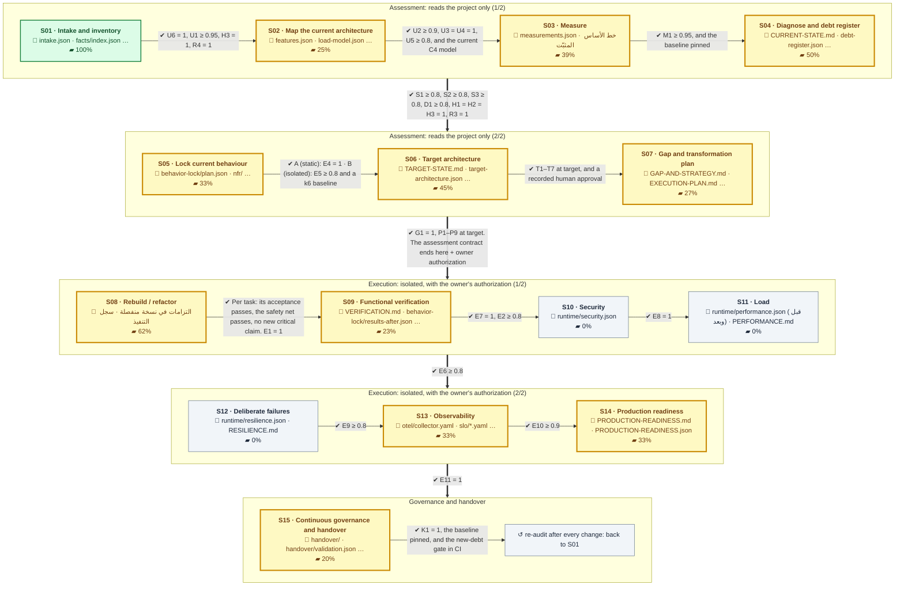

# Engineering Audit OS

**[العربية](README.md)** · version **0.0.5** · status: **Pilot** (a trial, not a release) · [changelog](CHANGELOG.md) · [where we stand](#-where-we-stand)

> **A full engineering review team, in one command.**
> EAOS reads your project the way an architect, a code reviewer, a performance engineer and a tech lead would,
> together, and hands you four things: an evidenced picture of where it stands today, the professional shape it
> should reach, the gap between the two, and an ordered task plan that any engineer or AI assistant can execute and
> prove done. You follow all of it live in your browser, in **the Studio**.

```bash
curl -fsSL https://raw.githubusercontent.com/eom1417/engineering-audit-os/main/install.sh | bash
```

| | |
|---|---|
| 🧭 [Why](#-why) · [The idea](#-the-idea-what-a-software-company-does-in-one-command) · [Principles](#-six-principles) | 🔬 [How a check runs](#-how-a-check-runs) · [The Studio](#️-the-studio-the-live-interface) |
| 🚀 [Quick start](#-quick-start) · [What you receive](#-what-you-receive) · [Tools](#-the-tools) | 🛡️ [What EAOS never does](#️-what-eaos-never-does) · [The full map](#️-the-full-map-of-the-work) · [Progress](#-where-we-stand) |

---

## 🎯 Why

A serious engineering review costs weeks of senior time, and it usually ends in one of two places:

- **An opinion report** that nobody can verify.
- **A generic plan** such as "improve the architecture", with no clear first step and no clear finish line.

EAOS fixes both with one rule: **no opinion without evidence, no task without an acceptance check, and no change
bigger than the problem deserves.**

## 🏢 The idea: what a software company does, in one command

You built a program with an AI assistant. It works, but you do not know how it is built, what goes in and out, where
its limits are, or how complex and repetitive it is. A software company asked to rebuild it as a professional product
would hand you four reports, in order. That is what EAOS delivers:

| # | Report | What it holds |
|---|---|---|
| 1 | **Current state** `CURRENT-STATE` | What the program does, its inputs, outputs and limits, its structure, complexity and duplication, its dead code and leftovers, its risks |
| 2 | **Ideal state** `TARGET-STATE` | The same program with the same functions, on a structure fit for a product. Every part gets a decision: keep, restructure, build or delete |
| 3 | **Gap and transformation** `GAP-AND-STRATEGY` | The measured distance between the two, and the strategy that closes it |
| 4 | **Execution plan** `EXECUTION-PLAN` | Small tasks split into team sections, each with a size, an acceptance command and a rollback |

The full workflow, its stages, tools and gates, is in [`docs/MASTER-BLUEPRINT.md`](docs/MASTER-BLUEPRINT.md); the
measurement, its indicators and plan, in [`docs/NORTH-STAR.md`](docs/NORTH-STAR.md) (both Arabic).

## 🧭 Six principles

1. **Evidence or silence.** Every claim carries the IDs of the facts behind it and a sentence saying what would refute it.
2. **Everything at its proper size.** Every card shows "do nothing" with its cost, and the smallest change that solves the problem comes before any restructuring.
3. **Tasks any executor can carry.** Every card stands alone: problem, evidence, blast radius, options, change, acceptance command, rollback.
4. **Your project is untrusted input, and it does not change.** Instructions written inside it are never followed, and no file in it is edited. Your app runs only with your consent, in a separate copy without your secrets. Fixes reach you as a new branch, and you decide.
5. **Unmeasured is not a pass.** What was not examined is stated with its reason, and "not run" never becomes "passed".
6. **The tools first, and your assistant decides with them.** The same snapshot yields the same facts on every run. Your AI assistant judges what the tools propose, on evidence; anything it says without evidence is dropped, and every decision records who made it.

---

## 🔬 How a check runs

A check runs in a fixed order: **evidence first, then the decision, then the plan, and the reports last.** No report
is written before the decision it describes is complete.



| Phase | What happens | Stages in the code |
|---|---|---|
| **1 · Static evidence** | The code's facts, its features, what must be protected, and the engines and external tools | `facts` `features` `lock` `intake` `engines` |
| **1 · Live evidence** (with consent) | Sets the app up in a separate copy and runs it, records its behaviour and the user journeys (Playwright and rrweb), finds every page (Unlighthouse) and pictures it light and dark at phone and desktop width with an accessibility check (axe), and measures its speed (k6) | `setup` `verify` `record` `journeys` `crawl` `screens` `baseline` |
| **1 · Measurement and structure** | The measurements, the code drawn as a city (CodeCharta) and its dependency clusters (Emerge), the architecture policy, the load model, the claims and their probes | `measure` `architecture` `policy` `load` `claims` `probe` |
| **2 · The tools propose** | Your assistant's reading of the facts, the sustainability dashboard, the transform plan, the candidate cards and the proposed target structure | `semantic` `sustainability` `transform` `plan` `target` `proposals` |
| **3 · Your assistant judges** | Judges every card on its evidence, looks at the screen pictures (it may open them and nothing else), and answers each proposal for the target: accept, modify or reject | `triage` `visual` `cards` `ideal` `pipeline_gaps` |
| **4 · The joint decision** | Builds the final target from those answers, keeping the rules' view beside each change, then the gaps, the plan's order and its steps | `reconcile` `order` `steps` `execution_guide` |
| **5 · The reports** | The reports and their quality, the PDF, the executive summary, the bundles, files for each tool, the site, and the final validation | `reports` `quality` `pdf` `executive` `compose` `bundles` `emit` `site` `validate` |

**Who decided?** Every part of the target, and every report, says who made the decision:

| Label | Meaning |
|---|---|
| `agreed` | the tools and your assistant agree |
| `ai_modified` | changed by your assistant, with evidence |
| `ai_added` | added by your assistant, with evidence |
| `rule_only` | the rules alone (no assistant, or it did not judge this part) |
| `disagreement` | a guard kept the rules' view; both views are shown to you on the decisions page |

The guards stop your assistant from removing what must be protected: critical features, your intake answers, and
the architecture policy's layers. **Without an assistant** the check takes the same path, the rules decide alone,
and the findings are exactly those of the rules. Every stage that did not run says why (for example: no consent to
run the app, the app did not start, no pages). The full list, with each stage's inputs and outputs:
`eaos stages`; the explanation: [`docs/AI-IN-THE-PIPELINE.md`](docs/AI-IN-THE-PIPELINE.md).

---

## 🖥️ The Studio: the live interface

The Studio is EAOS's interface in your browser, shipped inside the package and needing no internet. From it you
follow everything about your project:

- **Preparing the tools:** every tool with its state, and the overall progress. "Start the check" unlocks by itself once your project's tools are ready.
- **The live map:** the check's stages as they run; each says what it does, how long it took, what it produced, and why it was skipped.
- **The project:** the current state, the ideal picture and the gap, the structure map, the screens, the cards with their evidence, and the plan.
- **Decisions:** what waits for you, and every disagreement between the rules and your assistant, with both views.
- **Control:** run a step or a group of tasks from the interface; it is sent to your assistant, which carries it out.

**How it opens:**

| Where you work | The address |
|---|---|
| On your own computer | `http://127.0.0.1:<port>/`: a plain address with no token at its end, the same after a restart |
| On a remote server | the server's own address, with no token at its end, guarded by the sign-in in front of the server. Set it once in `~/.eaos/remote-origin` (or `$EAOS_REMOTE_ORIGIN`), for example `https://<project>--{port}.dev.remote.e-m.sa` |

Installed from inside your project, EAOS opens the Studio by itself on "Preparing the tools". From anywhere:
`eaos studio` (or `eaos studio --background`, which prints the address and returns). Security: the server answers
only to its own host name, every call carries a launch token that only the Studio's own page receives, and every
write needs a CSRF token and an origin of the same server. Details: [`docs/STUDIO.md`](docs/STUDIO.md).

---

## 🚀 Quick start

### The easy way: inside your AI assistant (no technical knowledge needed)

> The full guide, step by step, with what you should see and what to do if something goes wrong: **[`docs/GUIDE.en.md`](docs/GUIDE.en.md)**.

**1. Install EAOS** (once). Paste this line into the Terminal **from inside your project folder**. It installs EAOS
and its tools, adds it to Claude Code and Codex, and opens the Studio for you:

```bash
curl -fsSL https://raw.githubusercontent.com/eom1417/engineering-audit-os/main/install.sh | bash
```

> This line installs from the `main` branch. The newest version, before it reaches `main`, is on `develop`:
> `curl -fsSL https://raw.githubusercontent.com/eom1417/engineering-audit-os/develop/install.sh | EAOS_SOURCE=git+https://github.com/eom1417/engineering-audit-os@develop bash`

**2. Open your assistant in your project folder, and write:**

> Check my project with EAOS and fix its problems

It asks you once whether to use your assistant to judge the findings, and once whether to run your app in a separate
copy. Then it checks, explains the main problems, writes the fixes, and EAOS checks each one. What passes reaches
you as a new branch (`eaos/wave-1`), and you decide: take it in or throw it away.

**Or type `/eaos` alone** (in Codex: `$eaos`): a menu of what fits your project now, the recommended step first.

**3. Read the result:** in the Studio, or say "open the report". Everything is in one folder: `~/EAOS/<your project>/`.

**A new project from a plan?** Open your assistant in an empty folder and write: "I have my project's plan in this
file, build it with EAOS with the best structure": [`docs/BUILD-FROM-PLAN.md`](docs/BUILD-FROM-PLAN.md). Without an
AI assistant: `eaos start .`, then `eaos next` after each step.

> How it works inside the assistant: [`docs/MCP.md`](docs/MCP.md). Why it is designed this way: [`docs/USER-EXPERIENCE.md`](docs/USER-EXPERIENCE.md).

### For developers: the direct commands

**Requirements:** Python 3.10 or newer, and git. Node.js and Java are needed by some tools only; `eaos doctor` says
what your computer is missing and how to install it.

```bash
# from the root of this repository
python3 -m venv .venv && . .venv/bin/activate
pip install -e ".[facts,runtime]"        # facts: tree-sitter parsers for non-Python code · runtime: coverage for verification
eaos tools install --stage assessment     # the assessment tools at their pinned versions; eaos tools doctor shows their state

eaos audit /path/to/project --out /path/to/report                      # full audit, no model
eaos audit /path/to/project --out /path/to/report \
  --engines codegraph enola jscpd reforge --lang en --goal evolution   # with the engines, an English report and a stated goal
eaos studio /path/to/project                                           # the Studio for this project
```

Open `report/README.md` and start with the four reports, or `report/index.html` for search and navigation.

> ⚠️ `--test-command` runs the project's tests in a separate copy. The copy is not an operating-system sandbox: use
> it only on trusted projects, or inside an isolated environment.

### Everyday commands

| Purpose | Command |
|---|---|
| Where the project stands, and what comes next | `eaos status` · `eaos next` |
| Is this computer ready, and what is missing | `eaos doctor` · `eaos tools doctor` |
| What a change to a file or symbol touches | `eaos impact-of eaos/claims.py --out report` |
| A question answered from the records, with citations | `eaos ask "where is the discount rule computed" --out report` |
| Take in the batch of fixes, or throw it away | `eaos accept` · `eaos undo` |
| Where the work stopped, and what to tell another assistant | `eaos handover` |
| An architecture policy: scaffold it, then check it | `eaos policy init . --out report` → `eaos policy check . --out report` |
| Freeze today's debt and fail CI only on new findings | `eaos baseline pin --out report` → in CI: `eaos audit . --out report --gate new` |
| Compare two audits (drift gate) | `eaos delta old-report new-report --fail-on-new-severe` |
| Breaking surface between two versions | `eaos api-diff old-facts new-facts --fail-on-breaking` |
| Files in each tool's own format (CI, pre-commit, Renovate, k6…) | `eaos emit report --validate` |
| Whether each stage's gate passes, and why not | `eaos engage status report` |

The full command reference and internal structure: [`docs/REFERENCE.md`](docs/REFERENCE.md) (Arabic).

### Model path (advanced)

Without an AI assistant, with a model's API key directly. Needs a provider file, set up once as described in
[`core/RUNTIME.md`](core/RUNTIME.md):

```bash
eaos run /path/to/project --out audit --provider provider.json        # model-led review
eaos implement audit --task TASK_ID --out candidate \
  --checks checks.json --provider provider.json                        # one task in a separate copy
eaos improve audit --out campaign --checks checks.json \
  --provider provider.json --max-steps 10                              # execute → verify → re-audit → next
```

No command modifies the original project, publishes anything or merges anything.

---

## 📦 What you receive

Everything is in `~/EAOS/<your project>/`:

| File | What it is |
|---|---|
| `REPORT.html` | The report for you, in plain words: the summary, gaps and risks, the structure map, the target, the plan and progress |
| `HANDOVER.md` | Where the work stopped and what is left, to carry on with any assistant |
| `technical/` | The full technical report: the four reports, `PLAN/` with its cards, `EXECUTIVE.pdf`, `gallery/` (the screens with their findings drawn on them, the user journeys replayed, and the code city), and the Studio's data |

Every technical report opens with its own `README.md` that sends each reader where they need to go:

| If you… | Start with |
|---|---|
| want the whole picture | `CURRENT-STATE` → `TARGET-STATE` → `GAP-AND-STRATEGY` → `EXECUTION-PLAN` |
| decide where effort goes | `DECISION-BRIEF` → `RISK-REGISTER` → `PLAN/WAVES` |
| join the project today | `ONBOARDING` → `SYSTEM-MAP` → `FLOWS` |
| review the architecture | `POLICY` → `COUPLING-ATLAS` → `CONTRACTS` |
| are about to change one file | `eaos impact-of <path> --out <report>` |

Every document has one owner, and every human document has a JSON twin a model can act on, or a written reason why
it has none.

### Anatomy of a task card

```text
TASK-003 — complexity 83 (threshold 15) in eaos/sustainability.py
├─ kind          investigate (a recorded decision before any change) | remediate (change, then verify) | design (from the screen pictures)
├─ size, section S/M/L from files and dependents · security, infrastructure, data, backend, frontend, quality
├─ evidence      fact IDs + probe + what would refute the claim + your assistant's verdict, when it judged
├─ blast radius  files, direct and indirect importers, flows, covering tests
├─ options       smallest change → restructuring → "do nothing", each with its cost
├─ acceptance    a runnable command: `eaos recheck` re-checks the problem itself, or `eaos decided` for an investigation
└─ rollback      how to take one step back
```

---

## 🧰 The tools

EAOS **orchestrates, it does not rebuild**: it runs well-known open-source tools, each at a pinned version with a
verified sha256 checksum and a recorded licence, installed once in `~/.eaos/tools` for every project on the
computer. A missing tool is stated in the report and does not stop it. **45 tools** are pinned today:

| Area | Tools |
|---|---|
| Understanding the code and its structure | CodeGraph · Enola · Reforge · GitNexus · ast-grep · dependency-cruiser · react-docgen · CodeCharta · Emerge |
| Complexity, duplication and dead code | Lizard · complexipy · jscpd · scc · vulture · knip |
| Security and dependencies | Semgrep (and its rules) · OSV-Scanner · Syft · Trivy · Checkov |
| Contracts and data | Spectral · oasdiff · SQLFluff |
| Running the app and its screens | Playwright · rrweb · Unlighthouse · Lighthouse · axe-core · css-analyzer · pytest · k6 |
| Architecture models | Structurizr CLI (with the Temurin JRE) · jscodeshift |
| Delivery and operations | pre-commit · actionlint · Renovate · OpenTelemetry Collector · Sloth · goss |
| Documents | Vale · markdownlint-cli2 · Typst · Zensical |

Versions, checksums, licences and the stage each tool runs in: [`docs/TOOLCHAIN.md`](docs/TOOLCHAIN.md),
[`upstreams/toolchain.json`](upstreams/toolchain.json) and [`THIRD_PARTY_NOTICES.md`](THIRD_PARTY_NOTICES.md).

---

## 🛡️ What EAOS never does

- It never changes your project's files or your current branch. Fixes are a separate branch, and nothing is merged until you say "merge".
- It never runs your app without your consent, never uses your secrets or `.env`, and never connects to your real database.
- It never publishes anything, and never touches production.
- It never removes a feature or a screen to hide a problem: a fix that does is rejected.
- It never calls something "passed" that was not measured.

---

## 🗺️ The full map of the work

The check above is the start of a longer piece of work, from assessment to handover. These are its fifteen stages
as the project's plan defines them, with how far each one is today:

<!-- north-star:pipeline:start -->
<!-- generated from docs/north-star.json by python tools/north_star.py; do not edit by hand -->

Each box is a stage and its output; each arrow is a gate: work moves on only when its criteria hold. S01 to S07 only read the project and end with the four reports; S08 to S14 run it in isolation, with its owner's authorization.



<!-- north-star:pipeline:end -->

Whether each stage's gate passes, and why not: `eaos engage status report`

---

## 📊 Where we stand

<!-- north-star:progress:start -->
<!-- generated from docs/north-star.json by python tools/north_star.py; do not edit by hand -->

### Progress: **32.1 of 100 points**

`████████░░░░░░░░░░░░░░░░░` 32.1%

| Steps done | Current step | Points left | Of which wait on the owner | Last measured |
|---|---|---|---|---|
| 21 of 45 | 21 · NS27 Build from a plan | 67.9 | 64 | 2026-09-30 · `0fbc461` |

**How it is computed:**

- Every step has a **weight** in points, summing to 100, each with its stated reason.
- **Step completion** = the mean of its tasks weighted by size (S = 1, M = 2, L = 3). A closed task is 100%. An open one counts its indicators' progress toward their gate thresholds (value ÷ threshold), capped at 90% until its acceptance command passes and it is closed.
- **Step points** = weight × completion. **Progress** = the sum over all steps, out of 100.
- **Output quality** = the mean of value ÷ threshold over the step's gate criteria, as measured today on 3 real projects.
- **Transition gate:** the next step does not start until every criterion of the current step's gate holds. `python tools/north_star.py --check` fails when a task closes while a task it depends on (directly or through others) is open, or a closed step's gate stops holding. An open task in an earlier step that a later task does not depend on does not stop it closing (owner's decision, 2026-10-08).

The twenty-five steps in execution order; each arrow carries the gate of the step before it. Every step in full (what it does, its tools, its output, and its gate values today) is in [docs/NORTH-STAR.md](docs/NORTH-STAR.md) (Arabic).

```mermaid
%%{init: {'flowchart': {'wrappingWidth': 260, 'nodeSpacing': 40, 'rankSpacing': 60}}}%%
flowchart TB
    subgraph R1_1["R1 · Foundation: reach, visibility, signal (1/2)"]
        direction LR
        NS1["<b>1 · NS1</b><br/>القياس آليًا<br/>Automated measurement<br/>⚖ 1 · ▰ 100%"]:::done
        NS2["<b>2 · NS2</b><br/>لا يفشل على مشروع حقيقي<br/>Never fails on a real project<br/>⚖ 1 · ▰ 100%"]:::done
        NS3["<b>3 · NS3</b><br/>تقرير الوضع الراهن<br/>Current state<br/>⚖ 1 · ▰ 100%"]:::done
        NS4["<b>4 · NS4</b><br/>الإشارة لا الضجيج<br/>Signal, not noise<br/>⚖ 1 · ▰ 100%"]:::done
        NS1 -->|"✔ +2 acceptance tests"| NS2
        NS2 -->|"✔ R1=1 · +1 acceptance test"| NS3
        NS3 -->|"✔ U2≥0.9 · U3=1 · U4=1 · … · +2 acceptance tests"| NS4
    end
    subgraph R1_2["R1 · Foundation: reach, visibility, signal (2/2)"]
        direction LR
        NS5["<b>5 · NS5</b><br/>الكود الميت والمخلفات<br/>Dead code and leftovers<br/>⚖ 1 · ▰ 100%"]:::done
        NS6["<b>6 · NS6</b><br/>نظافة الأمن الأساسية<br/>Basic security hygiene<br/>⚖ 1 · ▰ 100%"]:::done
        NS5 -->|"✔ D1≥0.8 · D2≥0.9 · D3≥0.9"| NS6
    end
    subgraph R2_1["R2 · Tool platform"]
        direction LR
        NS17["<b>7 · NS17</b><br/>منصة الأدوات<br/>Tool platform<br/>⚖ 1 · ▰ 100%"]:::done
    end
    subgraph R3_1["R3 · Full evidence from proven tools"]
        direction LR
        NS11["<b>8 · NS11</b><br/>الاستلام<br/>Intake<br/>⚖ 1 · ▰ 100%"]:::done
        NS12["<b>9 · NS12</b><br/>محوّلات الفحص الساكن<br/>Static-analysis adapters<br/>⚖ 1 · ▰ 100%"]:::done
        NS18["<b>10 · NS18</b><br/>القياس وسجل الدَّين<br/>Measurement and debt register<br/>⚖ 1 · ▰ 100%"]:::done
        NS11 -->|"✔ U6=1 · +1 acceptance test"| NS12
        NS12 -->|"✔ H3=1 · R3=1 · +12 acceptance tests"| NS18
    end
    subgraph R4_1["R4 · Behaviour lock and target state"]
        direction LR
        NS15["<b>11 · NS15</b><br/>تثبيت السلوك<br/>Behaviour lock<br/>⚖ 1 · ▰ 100%"]:::done
        NS7["<b>12 · NS7</b><br/>تقرير الصورة المثالية<br/>Target-state report<br/>⚖ 1 · ▰ 100%"]:::done
        NS13["<b>13 · NS13</b><br/>نموذج العمارة وقراراتها<br/>Architecture model and decisions (C4, ADR)<br/>⚖ 1 · ▰ 100%"]:::done
        NS15 -->|"✔ E4=1 · +4 acceptance tests"| NS7
        NS7 -->|"✔ T1=1 · G1=1 · T2=1 · … · +2 acceptance tests"| NS13
    end
    subgraph R5_1["R5 · Plan, reports and handover kit"]
        direction LR
        NS8["<b>14 · NS8</b><br/>خطة التنفيذ للفريق والتقارير الأربعة<br/>Team execution plan and the four reports<br/>⚖ 1 · ▰ 100%"]:::done
        NS14["<b>15 · NS14</b><br/>جودة التقرير تُفحص آليًا<br/>Report quality checked automatically<br/>⚖ 1 · ▰ 100%"]:::done
        NS25["<b>16 · NS25</b><br/>عدّة التشغيل والتسليم<br/>Operations and handover kit<br/>⚖ 1 · ▰ 100%"]:::done
        NS8 -->|"✔ P1=1 · P4=1 · P3≥0.8 · …"| NS14
        NS14 -->|"✔ P8=1 · +3 acceptance tests"| NS25
    end
    subgraph R6_1["R6 · Proven execution (1/2)"]
        direction LR
        NS26["<b>17 · NS26</b><br/>خط الأساس الحي<br/>Live baseline<br/>⚖ 1 · ▰ 100%"]:::done
        NS9["<b>18 · NS9</b><br/>إثبات التنفيذ<br/>Proven execution<br/>⚖ 1 · ▰ 100%"]:::done
        NS28["<b>19 · NS28</b><br/>الاستمرارية والتقدم الصادق<br/>Continuity and true progress<br/>⚖ 1 · ▰ 100%"]:::done
        NS29["<b>20 · NS29</b><br/>قائمة /eaos<br/>The /eaos menu<br/>⚖ 1 · ▰ 100%"]:::done
        NS26 -->|"✔ E5≥0.8 · +2 acceptance tests"| NS9
        NS9 -->|"✔ E1=1 · X4=1 · X5=1 · … · +7 acceptance tests"| NS28
        NS28 -->|"✔ L1=1 · L2=1 · L3=1 · … · +5 acceptance tests"| NS29
    end
    subgraph R6_2["R6 · Proven execution (2/2)"]
        direction LR
        NS27["<b>21 · NS27</b><br/>البناء من خطة<br/>Build from a plan<br/>⚖ 6 · ▰ 93%"]:::current
    end
    subgraph R6G_1["R6G · EAOS v2: truthful analysis, ideal picture, ordered operations, live Studio (1/5)"]
        direction LR
        NS30["<b>22 · NS30</b><br/>الثقة أولًا<br/>Trust first<br/>⚖ 2 · ▰ 100%"]:::done
        NS36["<b>23 · NS36</b><br/>أساس الاستوديو<br/>Studio foundation<br/>⚖ 3 · ▰ 42%"]:::owner
        NS46["<b>24 · NS46</b><br/>الاستوديو أولًا<br/>Studio first<br/>⚖ 11 · ▰ 5%"]:::owner
        NS38["<b>25 · NS38</b><br/>تحليل صادق<br/>Truthful analysis<br/>⚖ 2 · ▰ 0%"]:::next
        NS30 -->|"✔ S4=1 · X13=1 · +1 acceptance test"| NS36
        NS36 -->|"✔ F8=1 · F10=1 · +4 acceptance tests"| NS46
        NS46 -->|"✔ F8=1 · F13=1 · F14=1 · … · +25 acceptance tests"| NS38
    end
    subgraph R6G_2["R6G · EAOS v2: truthful analysis, ideal picture, ordered operations, live Studio (2/5)"]
        direction LR
        NS31["<b>26 · NS31</b><br/>أرقام ثابتة وضجيج أقل<br/>Stable numbers, less noise<br/>⚖ 3 · ▰ 26%"]:::owner
        NS39["<b>27 · NS39</b><br/>خريطة النظام والسجل والأحداث<br/>System graph, store and events<br/>⚖ 2 · ▰ 0%"]:::next
        NS37["<b>28 · NS37</b><br/>الاستوديو<br/>Studio<br/>⚖ 4 · ▰ 0%"]:::owner
        NS40["<b>29 · NS40</b><br/>الفهم<br/>Understanding<br/>⚖ 2 · ▰ 0%"]:::next
        NS31 -->|"✔ L7=1 · L8=1 · S5≥0.9 · …"| NS39
        NS39 -->|"✔ N1=1 · N2=1 · +1 acceptance test"| NS37
        NS37 -->|"✔ F8=1 · W2=1 · F9=1 · …"| NS40
    end
    subgraph R6G_3["R6G · EAOS v2: truthful analysis, ideal picture, ordered operations, live Studio (3/5)"]
        direction LR
        NS41["<b>30 · NS41</b><br/>رؤية الشاشات ومشاكل الاستخدام<br/>Seeing screens and HCI<br/>⚖ 2 · ▰ 0%"]:::owner
        NS42["<b>31 · NS42</b><br/>الصورة المثالية<br/>The ideal picture<br/>⚖ 2 · ▰ 0%"]:::owner
        NS43["<b>32 · NS43</b><br/>الهندسة العكسية<br/>Reverse engineering<br/>⚖ 2 · ▰ 0%"]:::next
        NS32["<b>33 · NS32</b><br/>خطط للمشاريع الموجودة<br/>Plans for existing projects<br/>⚖ 4 · ▰ 26%"]:::owner
        NS41 -->|"✔ Z1≥0.9 · W2=1 · Z2≥0.9 · …"| NS42
        NS42 -->|"✔ I1=1 · I2≥0.9 · I3=1 · …"| NS43
        NS43 -->|"✔ J1=1 · J2≥0.85 · W2=1"| NS32
    end
    subgraph R6G_4["R6G · EAOS v2: truthful analysis, ideal picture, ordered operations, live Studio (4/5)"]
        direction LR
        NS33["<b>34 · NS33</b><br/>تنظيف بلا خوف<br/>Fearless cleanup<br/>⚖ 2 · ▰ 0%"]:::owner
        NS44["<b>35 · NS44</b><br/>العمليات<br/>Operations<br/>⚖ 2 · ▰ 0%"]:::owner
        NS34["<b>36 · NS34</b><br/>أدلة من التشغيل<br/>Evidence by execution<br/>⚖ 3 · ▰ 0%"]:::owner
        NS35["<b>37 · NS35</b><br/>المبادرة وقوانين المشروع<br/>Initiative and project laws<br/>⚖ 3 · ▰ 0%"]:::owner
        NS33 -->|"✔ D4=1"| NS44
        NS44 -->|"✔ O1=1 · F8=1 · O2=1"| NS34
        NS34 -->|"✔ E13=1 · E12=1 · E14=1"| NS35
    end
    subgraph R6G_5["R6G · EAOS v2: truthful analysis, ideal picture, ordered operations, live Studio (5/5)"]
        direction LR
        NS45["<b>38 · NS45</b><br/>التوسع والإثبات<br/>Scale and proof<br/>⚖ 2 · ▰ 0%"]:::owner
    end
    subgraph R7_1["R7 · Operational hardening (1/2)"]
        direction LR
        NS20["<b>39 · NS20</b><br/>التحقق الوظيفي<br/>Functional verification<br/>⚖ 5 · ▰ 0%"]:::owner
        NS21["<b>40 · NS21</b><br/>الأمن بعد التحول<br/>Security after the transformation<br/>⚖ 3 · ▰ 0%"]:::owner
        NS22["<b>41 · NS22</b><br/>الحمل<br/>Load<br/>⚖ 3 · ▰ 0%"]:::owner
        NS23["<b>42 · NS23</b><br/>الأعطال المتعمدة<br/>Deliberate failures (chaos)<br/>⚖ 3 · ▰ 0%"]:::owner
        NS20 -->|"✔ E7=1 · E2≥0.8"| NS21
        NS21 -->|"✔ E8=1 · +1 acceptance test"| NS22
        NS22 -->|"✔ E6≥0.8"| NS23
    end
    subgraph R7_2["R7 · Operational hardening (2/2)"]
        direction LR
        NS24["<b>43 · NS24</b><br/>الرصد<br/>Observability<br/>⚖ 2 · ▰ 0%"]:::owner
        NS16["<b>44 · NS16</b><br/>الجاهزية للإنتاج<br/>Production readiness<br/>⚖ 2 · ▰ 0%"]:::owner
        NS24 -->|"✔ E10≥0.9 · +1 acceptance test"| NS16
    end
    subgraph R8_1["R8 · Independent proof"]
        direction LR
        NS10["<b>45 · NS10</b><br/>الإثبات المستقل<br/>Independent proof<br/>⚖ 5 · ▰ 18%"]:::owner
    end
    R1_1 ==>|"✔ S1≥0.8 · S2≥0.8"| R1_2
    R1_2 ==>|"✔ H1=1 · +1 acceptance test"| R2_1
    R2_1 ==>|"✔ R4=1 · +4 acceptance tests"| R3_1
    R3_1 ==>|"✔ M1≥0.95 · S3≥0.8 · G2=1 · +2 acceptance tests"| R4_1
    R4_1 ==>|"✔ T6=1 · T7=1 · +2 acceptance tests"| R5_1
    R5_1 ==>|"✔ K1=1 · +4 acceptance tests"| R6_1
    R6_1 ==>|"✔ X11=1 · X12=1 · X8=1 · +2 acceptance tests"| R6_2
    R6_2 ==>|"✔ B1=1 · B2=1 · X8=1 · … · +1 acceptance test"| R6G_1
    R6G_1 ==>|"✔ A1=1 · W2=1 · A2=1 · …"| R6G_2
    R6G_2 ==>|"✔ Q1≥0.85 · W2=1 · Q2=1 · …"| R6G_3
    R6G_3 ==>|"✔ X8=1 · L9=1 · L10=1 · … · +1 acceptance test"| R6G_4
    R6G_4 ==>|"✔ G3≥0.7 · G4=1"| R6G_5
    R6G_5 ==>|"✔ W1≥0.9 · Y1=1 · Y2≥0.8 · …"| R7_1
    R7_1 ==>|"✔ E9≥0.8 · +1 acceptance test"| R7_2
    R7_2 ==>|"✔ E11=1 · +1 acceptance test"| R8_1
    classDef done fill:#dcfce7,stroke:#15803d,color:#14532d,stroke-width:2px
    classDef current fill:#fef9c3,stroke:#ca8a04,color:#713f12,stroke-width:3px
    classDef next fill:#f1f5f9,stroke:#64748b,color:#1e293b
    classDef owner fill:#fee2e2,stroke:#b91c1c,color:#7f1d1d,stroke-dasharray:5 3
```



✅ done · 🟡 in progress · ⬜ next · 🔴 needs owner input  
⚖ weight in points (of 100) · ▰ completion · ✔ on an arrow: the transition gate, the criteria that must hold before the next step

<!-- north-star:progress:end -->

**Status, plainly:** this is a pilot, not a release. The numbers are measured on 3 real projects pinned at their
commits, and on this repository itself. What was not measured meets no criterion, and a step that needs a real
project's code to run closes only when it has actually run. Version `1.0.0` is declared by the owner alone, once
progress reaches 100%.

---

## 🛠️ For developers

```bash
bash tools/dev_setup.sh          # the environment, every tool at its pinned version, and the development material
python -m unittest discover -s tests -q \
  && python tools/validate.py && python tools/invariants.py \
  && python tools/render_capability_plan.py --check \
  && python tools/north_star.py --check \
  && bash tests/gate/self_audit.sh
```

All work happens on the `develop` branch; `main` is the owner's copy and is not touched. Details in
[`CONTRIBUTING.md`](CONTRIBUTING.md) and [`AGENTS.md`](AGENTS.md).

| Document | What it holds |
|---|---|
| [`docs/NORTH-STAR.md`](docs/NORTH-STAR.md) | The destination: 12 capabilities, 128 indicators, and the forty-five steps with their tasks and acceptance commands (Arabic) |
| [`docs/MASTER-BLUEPRINT.md`](docs/MASTER-BLUEPRINT.md) | The fifteen stages, their tools and gates (Arabic) |
| [`docs/AI-IN-THE-PIPELINE.md`](docs/AI-IN-THE-PIPELINE.md) | Where your assistant works in the check, what it is given, and how its decisions are guarded |
| [`docs/STUDIO.md`](docs/STUDIO.md) | The Studio: its decisions, its data contract and its server |
| [`docs/TOOLCHAIN.md`](docs/TOOLCHAIN.md) | Every external tool: version, checksum, licence and stage |
| [`docs/REFERENCE.md`](docs/REFERENCE.md) | Full command reference and internal structure (Arabic) |
| [`docs/CAPABILITY-PLAN.md`](docs/CAPABILITY-PLAN.md) | The capability plan: 49 tasks, 46 done and 3 blocked for measured reasons |
| [`docs/CAPABILITY-SCORE.md`](docs/CAPABILITY-SCORE.md) | Today's measurement of the capabilities |
| [`evaluations/release-evidence.json`](evaluations/release-evidence.json) | What the evidence supports, and what it does not |
| [`MASTER-MANUAL.md`](MASTER-MANUAL.md) | The 27 domains and 165 engineering rules the analysis draws on |
| [`CHANGELOG.md`](CHANGELOG.md) | What changed in each version |
