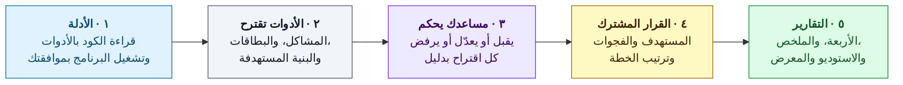
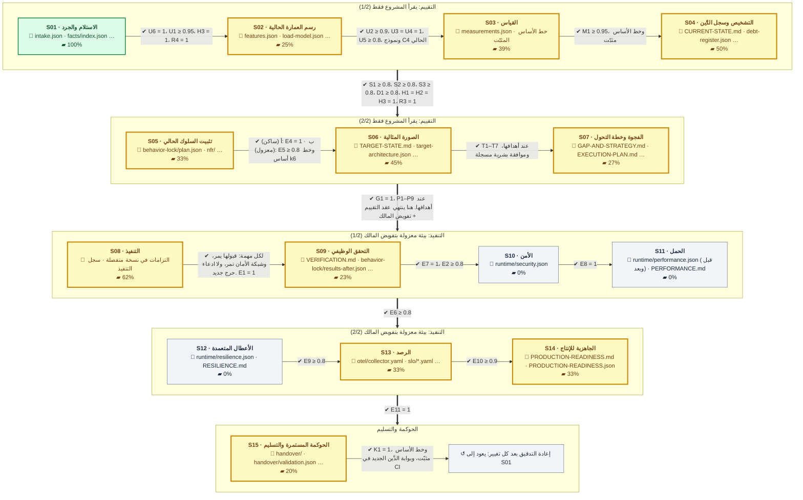

# Engineering Audit OS — نظام التدقيق الهندسي

**[English](README.en.md)** · الإصدار **0.0.5** · الحالة: **Pilot** (تجريبي، لا إصدار رسمي) · [سجل التغييرات](CHANGELOG.md) · [أين نحن من الوجهة](#-أين-نحن-من-الوجهة)

> **فريق مراجعة هندسية كامل، في أمر واحد.**
> يقرأ مشروعك كما يقرؤه مهندس معماري ومراجع كود ومهندس أداء وقائد تقني معًا، ويسلّمك أربعة أشياء: صورة موثّقة
> للوضع الراهن، والشكل الاحترافي الذي يجب أن يصل إليه، والفجوة بينهما، وخطة مهام مرتّبة ينفّذها أي مهندس أو أي
> مساعد ذكي ويثبت أنها نجحت. وتتابع كل هذا من واجهة حية في متصفحك: **الاستوديو**.

```bash
curl -fsSL https://raw.githubusercontent.com/eom1417/engineering-audit-os/main/install.sh | bash
```

| | |
|---|---|
| 🧭 [لماذا](#-لماذا-هذا-المشروع) · [الفكرة](#-الفكرة-ما-تفعله-شركة-برمجية-في-أمر-واحد) · [المبادئ](#-المبادئ-الستة) | 🔬 [كيف يجري الفحص](#-كيف-يجري-الفحص) · [الاستوديو](#️-الاستوديو-الواجهة-الحية) |
| 🚀 [البدء السريع](#-البدء-السريع) · [ماذا تستلم](#-ماذا-تستلم) · [الأدوات](#-الأدوات) | 🛡️ [ما لا يفعله أبدًا](#️-ما-لا-يفعله-eaos-أبدًا) · [خريطة العمل](#️-خريطة-العمل-الكاملة) · [التقدم](#-أين-نحن-من-الوجهة) |

---

## 🎯 لماذا هذا المشروع

المراجعة الهندسية الجادة تكلّف أسابيع من وقت كبار المهندسين، وتنتهي غالبًا بأحد أمرين:

- **تقرير آراء** لا يستطيع أحد التحقق منه.
- **خطة عامة**، مثل «حسّنوا البنية»، لا يعرف أحد من أين يبدأ تنفيذها ولا متى تنتهي.

EAOS يعالج الأمرين بقاعدة واحدة: **لا رأي بلا دليل، ولا مهمة بلا معيار قبول، ولا تغيير أكبر مما تستحقه المشكلة.**

## 🏢 الفكرة: ما تفعله شركة برمجية، في أمر واحد

بنيتَ برنامجًا مع مساعد ذكي. البرنامج يعمل، لكنك لا تعرف كيف بُني، ولا مداخله ومخارجه، ولا حدوده، ولا تعقيده
وتكراره. لو ذهبت إلى شركة برمجية لتعيد إنتاجه منتجًا احترافيًا، ستسلّمك أربعة تقارير بالترتيب، وهي ما يسلّمه EAOS:

| # | التقرير | ماذا فيه |
|---|---|---|
| 1 | **الوضع الراهن** `CURRENT-STATE` | ماذا يفعل البرنامج، ومداخله ومخارجه وحدوده، وبنيته، وتعقيده وتكراره، وكوده الميت ومخلفاته، ومخاطره |
| 2 | **الصورة المثالية** `TARGET-STATE` | البرنامج نفسه بوظائفه نفسها، ببنية تصلح منتجًا. لكل جزء قرار: يبقى، أو يُعاد ترتيبه، أو يُبنى، أو يُحذف |
| 3 | **الفجوة والتحول** `GAP-AND-STRATEGY` | المسافة المقيسة بين الاثنين، والاستراتيجية التي تقطعها |
| 4 | **خطة التنفيذ** `EXECUTION-PLAN` | مهام صغيرة مقسمة على أقسام فريق، لكل منها حجم وأمر قبول وطريقة تراجع |

سير العمل الكامل بمراحله وأدواته وبواباته في [`docs/MASTER-BLUEPRINT.md`](docs/MASTER-BLUEPRINT.md)، والقياس
بمؤشراته وخطته في [`docs/NORTH-STAR.md`](docs/NORTH-STAR.md).

## 🧭 المبادئ الستة

1. **دليل أو صمت.** كل ادعاء يحمل معرّفات الحقائق التي تثبته، وجملة تحدد ما الذي ينقضه.
2. **كل شيء بقدره.** كل بطاقة تعرض خيار «لا نفعل شيئًا» مع كلفته، وأصغر تغيير يحل المشكلة يُقدَّم على إعادة الهيكلة.
3. **مهام يحملها أي منفّذ.** كل بطاقة مكتفية بذاتها: المشكلة، الدليل، نطاق الأثر، الخيارات، التغيير، أمر القبول، التراجع.
4. **مشروعك مدخل غير موثوق، ولا يتغيّر.** لا تُتَّبع أي تعليمات مكتوبة داخله، ولا يُعدَّل ملف فيه. لا يُشغَّل
   برنامجك إلا بموافقتك، وفي نسخة منفصلة بلا أسرارك. الإصلاحات تصلك فرعًا جديدًا، وأنت تقرر.
5. **غير المقيس ليس نجاحًا.** ما لم يُفحص يُذكر صراحة مع سببه، ولا يتحول «لم يُشغَّل» إلى «نجح».
6. **الأدوات أولًا، ومساعدك يشارك القرار.** نفس اللقطة تعطي نفس الحقائق في كل تشغيل. مساعدك الذكي يحكم على ما
   تقترحه الأدوات بدليل، وكل ما يقوله بلا دليل يُحذف، وكل قرار يُكتب معه من اتخذه.

---

## 🔬 كيف يجري الفحص

الفحص يمشي بترتيب ثابت: **الأدلة أولًا، ثم القرار، ثم الخطة، والتقارير في الآخر.** لا يُكتب تقرير قبل أن يكتمل
القرار الذي يصفه.



| المرحلة | ماذا يحدث | المراحل في الكود |
|---|---|---|
| **١ · الأدلة الساكنة** | حقائق الكود، والميزات، وما يجب حمايته، وتشغيل المحرّكات والأدوات الخارجية | `facts` `features` `lock` `intake` `engines` |
| **١ · الأدلة الحية** (بموافقتك) | يجهّز البرنامج في نسخة منفصلة ويشغّله، ويسجّل سلوكه ورحلات المستخدم (Playwright وrrweb)، ويجد كل صفحة (Unlighthouse) ويصوّرها فاتحة وداكنة على الجوال والحاسب مع فحص الوصول (axe)، ويقيس السرعة (k6) | `setup` `verify` `record` `journeys` `crawl` `screens` `baseline` |
| **١ · القياس والبنية** | القياسات، وخريطة الكود كمدينة (CodeCharta) وعناقيد الاعتماد (Emerge)، والسياسة المعمارية، ونموذج الحمل، والادعاءات ومجسّاتها | `measure` `architecture` `policy` `load` `claims` `probe` |
| **٢ · الأدوات تقترح** | قراءة مساعدك للحقائق، ولوحة الاستدامة، وخطة التحول، والبطاقات المرشحة، والبنية المستهدفة المقترحة | `semantic` `sustainability` `transform` `plan` `target` `proposals` |
| **٣ · مساعدك يحكم** | يحكم على كل بطاقة بدليلها، وينظر في صور الشاشات (يفتحها ولا شيء غيرها)، ويجيب على كل اقتراح للمستهدف: قبول أو تعديل أو رفض | `triage` `visual` `cards` `ideal` `pipeline_gaps` |
| **٤ · القرار المشترك** | يبني المستهدف النهائي من الإجابات مع حفظ رأي القواعد بجانب كل تغيير، ثم الفجوات وترتيب الخطة وخطواتها | `reconcile` `order` `steps` `execution_guide` |
| **٥ · التقارير** | التقارير وجودتها، وPDF، والملخص التنفيذي، والحزم، والملفات الجاهزة للأدوات، والموقع، والتحقق النهائي | `reports` `quality` `pdf` `executive` `compose` `bundles` `emit` `site` `validate` |

**من قرّر؟** كل جزء من المستهدف، وكل تقرير، يقول من اتخذ القرار:

| العلامة | المعنى |
|---|---|
| `agreed` | اتفقت عليه الأدوات ومساعدك |
| `ai_modified` | عدّله مساعدك، بدليل |
| `ai_added` | أضافه مساعدك، بدليل |
| `rule_only` | القواعد وحدها (لا مساعد، أو لم يحكم عليه) |
| `disagreement` | خلاف: بقي رأي القواعد بضابط، والرأيان معروضان لك في صفحة القرارات |

الضوابط تمنع مساعدك من حذف ما يجب حمايته: الميزات الحرجة، وإجاباتك في الاستلام، وطبقات السياسة المعمارية.
**بلا مساعد** يمشي الفحص في الطريق نفسه، والقواعد تقرر وحدها، والنتائج مطابقة لنتائج القواعد حرفيًا. وكل مرحلة
لم تعمل تقول لماذا (مثلًا: لم توافق على التشغيل، أو البرنامج لم يشتغل، أو لا صفحات). القائمة الكاملة بمدخلات كل
مرحلة ومخرجاتها: `eaos stages`، والشرح في [`docs/AI-IN-THE-PIPELINE.md`](docs/AI-IN-THE-PIPELINE.md).

---

## 🖥️ الاستوديو: الواجهة الحية

الاستوديو هو واجهة EAOS في متصفحك، مبني مع الحزمة ولا يحتاج إنترنت. منه تتابع كل شيء عن مشروعك:

- **تجهيز الأدوات:** كل أداة وحالتها والتقدم الكلي. زر «ابدأ الفحص» يُفتح وحده حين تجهز أدوات مشروعك.
- **الخريطة الحية:** مراحل الفحص وهي تعمل، وكل مرحلة تقول ماذا تفعل، وكم أخذت، وماذا أنتجت، ولماذا تخطّاها.
- **المشروع:** الوضع الراهن، والصورة المثالية والفجوة، وخريطة البنية، والشاشات، والبطاقات بأدلتها، والخطة.
- **القرارات:** ما ينتظر رأيك، وكل خلاف بين القواعد ومساعدك برأييهما.
- **التحكم:** تشغيل خطوة أو مجموعة مهام من الواجهة، فتُرسل إلى مساعدك وينفّذها.

**كيف يُفتح:**

| أين تعمل | العنوان |
|---|---|
| على جهازك | `http://127.0.0.1:<المنفذ>/`: عنوان بسيط بلا رمز في آخره، يبقى نفسه بعد إعادة التشغيل |
| على خادم عن بعد | عنوان الخادم نفسه، بلا رمز في آخره، ويحميه تسجيل الدخول الذي أمام الخادم. تضبطه مرة واحدة في `~/.eaos/remote-origin` (أو `$EAOS_REMOTE_ORIGIN`)، مثلًا `https://<project>--{port}.dev.remote.e-m.sa` |

بعد التثبيت من داخل مشروعك يفتح الاستوديو وحده على «تجهيز الأدوات». ومن أي مكان: `eaos studio` (أو
`eaos studio --background` ليعطيك العنوان ويرجع). الأمان: الخادم يقبل اسم مضيفه فقط، وكل نداء يحمل رمز تشغيل تأخذه
صفحة الاستوديو نفسها، وكل أمر كتابة يحتاج رمز CSRF ومصدرًا من الخادم نفسه. التفاصيل في [`docs/STUDIO.md`](docs/STUDIO.md).

---

## 🚀 البدء السريع

### الطريقة الأسهل: داخل مساعدك الذكي (بلا خبرة تقنية)

> الدليل الكامل خطوة بخطوة، مع النتيجة المتوقعة وحلول الأخطاء: **[`docs/GUIDE.md`](docs/GUIDE.md)**.

**١. ثبّت EAOS** (مرة واحدة). الصق السطر في الطرفية **وأنت داخل مجلد مشروعك**. يثبّت EAOS وأدواته، ويضيفه إلى
Claude Code وCodex، ويفتح لك الاستوديو:

```bash
curl -fsSL https://raw.githubusercontent.com/eom1417/engineering-audit-os/main/install.sh | bash
```

> هذا السطر يثبّت من الفرع `main`. أحدث نسخة، قبل أن تصل إلى `main`، في الفرع `develop`:
> `curl -fsSL https://raw.githubusercontent.com/eom1417/engineering-audit-os/develop/install.sh | EAOS_SOURCE=git+https://github.com/eom1417/engineering-audit-os@develop bash`

**٢. افتح مساعدك في مجلد مشروعك، واكتب له:**

> افحص مشروعي بـ EAOS وأصلح مشاكله

يسألك مرة واحدة إن كان يستخدم مساعدك في الحكم على النتائج، ومرة إن كان يشغّل برنامجك في نسخة منفصلة. بعدها
يفحص، ويشرح لك أهم المشاكل، ويكتب الإصلاحات، وEAOS يفحص كل إصلاح. ما ينجح يصلك فرعًا جديدًا (`eaos/wave-1`)،
وأنت تقرر: تعتمده أو تتراجع عنه.

**أو اكتب `/eaos` وحدها** (في Codex: `$eaos`): تظهر قائمة بما يناسب مشروعك الآن، وأولها الخطوة الموصى بها.

**٣. اقرأ النتيجة:** في الاستوديو، أو قل لمساعدك «افتح لي التقرير». كل المخرجات في مجلد واحد:
`~/EAOS/<اسم مشروعك>/`.

**مشروع جديد من خطة؟** افتح مساعدك في مجلد فارغ واكتب: «عندي خطة مشروع في هذا الملف، ابنه بـ EAOS بأفضل هيكلة»:
[`docs/BUILD-FROM-PLAN.md`](docs/BUILD-FROM-PLAN.md). وبلا مساعد ذكي: `eaos start .` ثم `eaos next` بعد كل خطوة.

> كيف يعمل داخل المساعد: [`docs/MCP.md`](docs/MCP.md). لماذا صُمّم هكذا: [`docs/USER-EXPERIENCE.md`](docs/USER-EXPERIENCE.md).

### للمطوّرين: الأوامر المباشرة

**المتطلبات:** Python 3.10 أو أحدث، وgit. Node.js وJava تلزم لبعض الأدوات فقط، و`eaos doctor` يقول لك ما ينقص
جهازك وكيف تثبّته.

```bash
# من جذر هذا المستودع
python3 -m venv .venv && . .venv/bin/activate
pip install -e ".[facts,runtime]"        # facts: محللات tree-sitter للغات غير Python · runtime: coverage للتحقق
eaos tools install --stage assessment     # أدوات التقييم بإصداراتها المثبّتة؛ eaos tools doctor يعرض حالتها

eaos audit /path/to/project --out /path/to/report                      # تدقيق كامل بلا نموذج
eaos audit /path/to/project --out /path/to/report \
  --engines codegraph enola jscpd reforge --lang en --goal evolution   # مع المحرّكات، وبتقرير إنجليزي، وبهدف محدد
eaos studio /path/to/project                                           # الاستوديو لهذا المشروع
```

افتح `report/README.md` وابدأ بالتقارير الأربعة، أو `report/index.html` للبحث والتنقل.

> ⚠️ `--test-command` يشغّل اختبارات المشروع في نسخة منفصلة. النسخة ليست sandbox لنظام التشغيل، فاستخدمه مع
> المشاريع الموثوقة فقط، أو داخل بيئة معزولة.

### أوامر العمل اليومي

| الغرض | الأمر |
|---|---|
| أين المشروع، وما التالي | `eaos status` · `eaos next` |
| هل الجهاز جاهز، وما الناقص | `eaos doctor` · `eaos tools doctor` |
| ما الذي يمسّه تغيير ملف أو رمز | `eaos impact-of eaos/claims.py --out report` |
| سؤال يُجاب من السجلات مع الاستشهاد | `eaos ask "أين تُحسب قاعدة الخصم" --out report` |
| اعتماد دفعة الإصلاحات أو التراجع عنها | `eaos accept` · `eaos undo` |
| أين توقف العمل، وماذا تقول لمساعد آخر | `eaos handover` |
| سياسة معمارية: إنشاؤها ثم فحصها | `eaos policy init . --out report` ← `eaos policy check . --out report` |
| تجميد الدَّين الحالي وإفشال CI على الجديد فقط | `eaos baseline pin --out report` ← وفي CI: `eaos audit . --out report --gate new` |
| مقارنة تدقيقين (بوابة انحراف) | `eaos delta old-report new-report --fail-on-new-severe` |
| سطح الكسر بين نسختين | `eaos api-diff old-facts new-facts --fail-on-breaking` |
| ملفات جاهزة بصيغ الأدوات (CI، pre-commit، Renovate، k6…) | `eaos emit report --validate` |
| هل تمر بوابة كل مرحلة، ولماذا لا | `eaos engage status report` |

المرجع الكامل للأوامر والبنية الداخلية: [`docs/REFERENCE.md`](docs/REFERENCE.md).

### مسار النموذج (متقدم)

بلا مساعد ذكي، وبمفتاح API لنموذج مباشرة. يحتاج ملف مزوّد يُعد مرة واحدة كما في [`core/RUNTIME.md`](core/RUNTIME.md):

```bash
eaos run /path/to/project --out audit --provider provider.json        # مراجعة يقودها النموذج
eaos implement audit --task TASK_ID --out candidate \
  --checks checks.json --provider provider.json                        # تنفيذ مهمة في نسخة منفصلة
eaos improve audit --out campaign --checks checks.json \
  --provider provider.json --max-steps 10                              # تنفيذ ← تحقق ← إعادة تدقيق ← التالية
```

لا يعدّل أي أمر المشروع الأصلي، ولا ينشر شيئًا، ولا يدمج شيئًا.

---

## 📦 ماذا تستلم

كل المخرجات في `~/EAOS/<اسم مشروعك>/`:

| الملف | ما هو |
|---|---|
| `REPORT.html` | التقرير لك بكلام بسيط: الملخص، والفجوات والمخاطر، وخريطة البنية، والمستهدف، والخطة والتقدم |
| `HANDOVER.md` | أين توقف العمل وماذا بقي، لتكمل مع أي مساعد |
| `technical/` | التقرير الفني الكامل: التقارير الأربعة، و`PLAN/` ببطاقاته، و`EXECUTIVE.pdf`، و`gallery/` (الشاشات بمشاكلها مرسومة عليها، وإعادة رحلات المستخدم، ومدينة الكود)، وبيانات الاستوديو |

كل تقرير فني يبدأ بـ`README.md` يوجّه كل قارئ إلى ما يعنيه:

| إن كنت… | ابدأ بـ |
|---|---|
| تريد الصورة كاملة | `CURRENT-STATE` ← `TARGET-STATE` ← `GAP-AND-STRATEGY` ← `EXECUTION-PLAN` |
| تقرّر أين يذهب الجهد | `DECISION-BRIEF` ← `RISK-REGISTER` ← `PLAN/WAVES` |
| تنضم للمشروع اليوم | `ONBOARDING` ← `SYSTEM-MAP` ← `FLOWS` |
| تراجع البنية | `POLICY` ← `COUPLING-ATLAS` ← `CONTRACTS` |
| ستغيّر ملفًا محددًا | `eaos impact-of <path> --out <report>` |

لكل وثيقة مالك واحد، ولكل وثيقة بشرية توأم JSON يقرؤه النموذج، أو سبب مكتوب لغيابه.

### تشريح بطاقة مهمة

```text
TASK-003 — التعقيد 83 (العتبة 15) في eaos/sustainability.py
├─ النوع        investigate (قرار مسجل قبل أي تغيير) | remediate (غيّر ثم تحقق) | design (من صور الشاشات)
├─ الحجم والقسم S/M/L من عدد الملفات والمعتمدين · أمن، بنية تحتية، بيانات، خلفية، واجهة، جودة
├─ الدليل        معرّفات الحقائق + المجسّ + ما الذي ينقض الادعاء + حكم مساعدك إن حكم
├─ نطاق الأثر    الملفات، المستوردون المباشرون وغير المباشرين، التدفقات، الاختبارات
├─ الخيارات      أصغر تغيير ← إعادة هيكلة ← «لا نفعل شيئًا» مع كلفة كل خيار
├─ القبول        أمر قابل للتشغيل: `eaos recheck` يعيد فحص المشكلة نفسها، أو `eaos decided` للتحقيق
└─ التراجع       كيف تعود خطوة واحدة إلى الوراء
```

---

## 🧰 الأدوات

EAOS **ينسّق ولا يعيد البناء**: يشغّل أدوات مفتوحة المصدر معروفة، كل واحدة بإصدار مثبّت وبصمة sha256 متحقَّقة
ورخصة مسجلة، وتُثبَّت مرة واحدة في `~/.eaos/tools` لكل مشاريع الجهاز. غياب أداة يُعلن في التقرير ولا يوقفه.
**45 أداة** مثبّتة اليوم:

| المجال | الأدوات |
|---|---|
| فهم الكود وبنيته | CodeGraph · Enola · Reforge · GitNexus · ast-grep · dependency-cruiser · react-docgen · CodeCharta · Emerge |
| التعقيد والتكرار والكود الميت | Lizard · complexipy · jscpd · scc · vulture · knip |
| الأمن والاعتماديات | Semgrep (وقواعده) · OSV-Scanner · Syft · Trivy · Checkov |
| العقود والبيانات | Spectral · oasdiff · SQLFluff |
| تشغيل البرنامج وشاشاته | Playwright · rrweb · Unlighthouse · Lighthouse · axe-core · css-analyzer · pytest · k6 |
| النماذج المعمارية | Structurizr CLI (مع Temurin JRE) · jscodeshift |
| التسليم والتشغيل | pre-commit · actionlint · Renovate · OpenTelemetry Collector · Sloth · goss |
| الوثائق | Vale · markdownlint-cli2 · Typst · Zensical |

الإصدارات والبصمات والرخص وفي أي مرحلة تعمل كل أداة: [`docs/TOOLCHAIN.md`](docs/TOOLCHAIN.md) و
[`upstreams/toolchain.json`](upstreams/toolchain.json) و[`THIRD_PARTY_NOTICES.md`](THIRD_PARTY_NOTICES.md).

---

## 🛡️ ما لا يفعله EAOS أبدًا

- لا يغيّر ملفات مشروعك ولا فرعك الحالي. الإصلاحات فرع منفصل، ولا يُدمج شيء إلا حين تقول «ادمج».
- لا يشغّل برنامجك بلا موافقتك، ولا يستعمل أسرارك ولا ملف `.env`، ولا يتصل بقاعدة بياناتك الحقيقية.
- لا ينشر شيئًا، ولا يلمس الإنتاج.
- لا يحذف ميزة أو شاشة ليخفي مشكلة: إصلاح يفعل ذلك يُرفض.
- لا يقول «نجح» عن شيء لم يُقَس.

---

## 🗺️ خريطة العمل الكاملة

الفحص أعلاه هو بداية عمل أطول، من التقييم إلى التسليم. هذه مراحله الخمس عشرة كما تعرّفها خطة المشروع، ونسبة
إنجاز كل مرحلة اليوم:

<!-- north-star:pipeline:start -->
<!-- مولَّد من docs/north-star.json بالأمر python tools/north_star.py؛ لا تحرّره يدويًا -->

كل صندوق مرحلة ومخرجها، وكل سهم بوابة: لا ينتقل العمل إلى المرحلة التالية إلا إذا تحققت معاييرها. المراحل S01 إلى S07 تقرأ المشروع فقط وتنتهي بالتقارير الأربعة؛ S08 إلى S14 تشغّله في بيئة معزولة بتفويض مالكه.



<!-- north-star:pipeline:end -->

هل تمر بوابة كل مرحلة، ولماذا لا: `eaos engage status report`

---

## 📊 أين نحن من الوجهة

<!-- north-star:progress:start -->
<!-- مولَّد من docs/north-star.json بالأمر python tools/north_star.py؛ لا تحرّره يدويًا -->

### التقدم: **32.1 من 100 نقطة**

`████████░░░░░░░░░░░░░░░░░` 32.1%

| الخطوات المكتملة | الخطوة الحالية | النقاط الباقية | منها تنتظر مدخلًا منك | آخر قياس |
|---|---|---|---|---|
| 21 من 45 | 21 · NS27 البناء من خطة | 67.9 | 64 | 2026-09-30 · `0fbc461` |

**كيف يُحسب:**

- لكل خطوة **وزن** بالنقاط، مجموعها 100، ومكتوب سبب كل وزن.
- **إنجاز الخطوة** = متوسط إنجاز مهامها موزونًا بحجمها (S = 1، M = 2، L = 3). المهمة المغلقة 100%. المفتوحة = تقدم مؤشراتها نحو حد بوابتها (القيمة ÷ الحد)، بسقف 90% حتى يمر أمر قبولها وتُغلق.
- **نقاط الخطوة** = الوزن × الإنجاز. **التقدم** = مجموع نقاط الخطوات من 100.
- **جودة المخرج** = متوسط (القيمة ÷ الحد) لمعايير بوابة الخطوة كما تُقاس اليوم على 3 مشاريع حقيقية.
- **بوابة الانتقال:** لا تبدأ الخطوة التالية قبل أن تتحقق كل معايير بوابة الخطوة الحالية. و`python tools/north_star.py --check` يفشل إن أُغلقت مهمة وما زالت مفتوحةً مهمةٌ تعتمد هي عليها (مباشرة أو بواسطة غيرها)، أو سقط معيار من بوابة خطوة مغلقة. مهمة مفتوحة في خطوة سابقة لا تعتمد عليها اللاحقة لا تمنع إغلاقها (قرار المالك 2026-10-08).

الخطوات الخمس والعشرون بترتيب التنفيذ. على كل سهم بوابة الخطوة التي قبله. التفصيل الكامل لكل خطوة (ماذا تفعل، وأدواتها، ومخرجها، وقيم بوابتها اليوم) في [docs/NORTH-STAR.md](docs/NORTH-STAR.md).

```mermaid
%%{init: {'flowchart': {'wrappingWidth': 260, 'nodeSpacing': 40, 'rankSpacing': 60}}}%%
flowchart TB
    subgraph R1_1["R1 · الأساس: الوصول والرؤية والإشارة (1/2)"]
        direction LR
        NS1["<b>1 · NS1</b><br/>القياس آليًا<br/>Automated measurement<br/>⚖ 1 · ▰ 100%"]:::done
        NS2["<b>2 · NS2</b><br/>لا يفشل على مشروع حقيقي<br/>Never fails on a real project<br/>⚖ 1 · ▰ 100%"]:::done
        NS3["<b>3 · NS3</b><br/>تقرير الوضع الراهن<br/>Current state<br/>⚖ 1 · ▰ 100%"]:::done
        NS4["<b>4 · NS4</b><br/>الإشارة لا الضجيج<br/>Signal, not noise<br/>⚖ 1 · ▰ 100%"]:::done
        NS1 -->|"✔ +2 اختبار قبول"| NS2
        NS2 -->|"✔ R1=1 · +1 اختبار قبول"| NS3
        NS3 -->|"✔ U2≥0.9 · U3=1 · U4=1 · … · +2 اختبار قبول"| NS4
    end
    subgraph R1_2["R1 · الأساس: الوصول والرؤية والإشارة (2/2)"]
        direction LR
        NS5["<b>5 · NS5</b><br/>الكود الميت والمخلفات<br/>Dead code and leftovers<br/>⚖ 1 · ▰ 100%"]:::done
        NS6["<b>6 · NS6</b><br/>نظافة الأمن الأساسية<br/>Basic security hygiene<br/>⚖ 1 · ▰ 100%"]:::done
        NS5 -->|"✔ D1≥0.8 · D2≥0.9 · D3≥0.9"| NS6
    end
    subgraph R2_1["R2 · منصة الأدوات: تثبيت، وقراءة، وتوليد، ومراحل، وعزل"]
        direction LR
        NS17["<b>7 · NS17</b><br/>منصة الأدوات<br/>Tool platform<br/>⚖ 1 · ▰ 100%"]:::done
    end
    subgraph R3_1["R3 · الأدلة الكاملة من الأدوات الجاهزة"]
        direction LR
        NS11["<b>8 · NS11</b><br/>الاستلام<br/>Intake<br/>⚖ 1 · ▰ 100%"]:::done
        NS12["<b>9 · NS12</b><br/>محوّلات الفحص الساكن<br/>Static-analysis adapters<br/>⚖ 1 · ▰ 100%"]:::done
        NS18["<b>10 · NS18</b><br/>القياس وسجل الدَّين<br/>Measurement and debt register<br/>⚖ 1 · ▰ 100%"]:::done
        NS11 -->|"✔ U6=1 · +1 اختبار قبول"| NS12
        NS12 -->|"✔ H3=1 · R3=1 · +12 اختبار قبول"| NS18
    end
    subgraph R4_1["R4 · تثبيت السلوك والصورة المثالية"]
        direction LR
        NS15["<b>11 · NS15</b><br/>تثبيت السلوك<br/>Behaviour lock<br/>⚖ 1 · ▰ 100%"]:::done
        NS7["<b>12 · NS7</b><br/>تقرير الصورة المثالية<br/>Target-state report<br/>⚖ 1 · ▰ 100%"]:::done
        NS13["<b>13 · NS13</b><br/>نموذج العمارة وقراراتها<br/>Architecture model and decisions (C4, ADR)<br/>⚖ 1 · ▰ 100%"]:::done
        NS15 -->|"✔ E4=1 · +4 اختبار قبول"| NS7
        NS7 -->|"✔ T1=1 · G1=1 · T2=1 · … · +2 اختبار قبول"| NS13
    end
    subgraph R5_1["R5 · الخطة والتقارير وعدّة التسليم"]
        direction LR
        NS8["<b>14 · NS8</b><br/>خطة التنفيذ للفريق والتقارير الأربعة<br/>Team execution plan and the four reports<br/>⚖ 1 · ▰ 100%"]:::done
        NS14["<b>15 · NS14</b><br/>جودة التقرير تُفحص آليًا<br/>Report quality checked automatically<br/>⚖ 1 · ▰ 100%"]:::done
        NS25["<b>16 · NS25</b><br/>عدّة التشغيل والتسليم<br/>Operations and handover kit<br/>⚖ 1 · ▰ 100%"]:::done
        NS8 -->|"✔ P1=1 · P4=1 · P3≥0.8 · …"| NS14
        NS14 -->|"✔ P8=1 · +3 اختبار قبول"| NS25
    end
    subgraph R6_1["R6 · التنفيذ المثبت (1/2)"]
        direction LR
        NS26["<b>17 · NS26</b><br/>خط الأساس الحي<br/>Live baseline<br/>⚖ 1 · ▰ 100%"]:::done
        NS9["<b>18 · NS9</b><br/>إثبات التنفيذ<br/>Proven execution<br/>⚖ 1 · ▰ 100%"]:::done
        NS28["<b>19 · NS28</b><br/>الاستمرارية والتقدم الصادق<br/>Continuity and true progress<br/>⚖ 1 · ▰ 100%"]:::done
        NS29["<b>20 · NS29</b><br/>قائمة /eaos<br/>The /eaos menu<br/>⚖ 1 · ▰ 100%"]:::done
        NS26 -->|"✔ E5≥0.8 · +2 اختبار قبول"| NS9
        NS9 -->|"✔ E1=1 · X4=1 · X5=1 · … · +7 اختبار قبول"| NS28
        NS28 -->|"✔ L1=1 · L2=1 · L3=1 · … · +5 اختبار قبول"| NS29
    end
    subgraph R6_2["R6 · التنفيذ المثبت (2/2)"]
        direction LR
        NS27["<b>21 · NS27</b><br/>البناء من خطة<br/>Build from a plan<br/>⚖ 6 · ▰ 93%"]:::current
    end
    subgraph R6G_1["R6G · EAOS v2: تحليل صادق، صورة مثالية، عمليات مرتبة، واستوديو حي (1/5)"]
        direction LR
        NS30["<b>22 · NS30</b><br/>الثقة أولًا<br/>Trust first<br/>⚖ 2 · ▰ 100%"]:::done
        NS36["<b>23 · NS36</b><br/>أساس الاستوديو<br/>Studio foundation<br/>⚖ 3 · ▰ 42%"]:::owner
        NS46["<b>24 · NS46</b><br/>الاستوديو أولًا<br/>Studio first<br/>⚖ 11 · ▰ 5%"]:::owner
        NS38["<b>25 · NS38</b><br/>تحليل صادق<br/>Truthful analysis<br/>⚖ 2 · ▰ 0%"]:::next
        NS30 -->|"✔ S4=1 · X13=1 · +1 اختبار قبول"| NS36
        NS36 -->|"✔ F8=1 · F10=1 · +4 اختبار قبول"| NS46
        NS46 -->|"✔ F8=1 · F13=1 · F14=1 · … · +25 اختبار قبول"| NS38
    end
    subgraph R6G_2["R6G · EAOS v2: تحليل صادق، صورة مثالية، عمليات مرتبة، واستوديو حي (2/5)"]
        direction LR
        NS31["<b>26 · NS31</b><br/>أرقام ثابتة وضجيج أقل<br/>Stable numbers, less noise<br/>⚖ 3 · ▰ 26%"]:::owner
        NS39["<b>27 · NS39</b><br/>خريطة النظام والسجل والأحداث<br/>System graph, store and events<br/>⚖ 2 · ▰ 0%"]:::next
        NS37["<b>28 · NS37</b><br/>الاستوديو<br/>Studio<br/>⚖ 4 · ▰ 0%"]:::owner
        NS40["<b>29 · NS40</b><br/>الفهم<br/>Understanding<br/>⚖ 2 · ▰ 0%"]:::next
        NS31 -->|"✔ L7=1 · L8=1 · S5≥0.9 · …"| NS39
        NS39 -->|"✔ N1=1 · N2=1 · +1 اختبار قبول"| NS37
        NS37 -->|"✔ F8=1 · W2=1 · F9=1 · …"| NS40
    end
    subgraph R6G_3["R6G · EAOS v2: تحليل صادق، صورة مثالية، عمليات مرتبة، واستوديو حي (3/5)"]
        direction LR
        NS41["<b>30 · NS41</b><br/>رؤية الشاشات ومشاكل الاستخدام<br/>Seeing screens and HCI<br/>⚖ 2 · ▰ 0%"]:::owner
        NS42["<b>31 · NS42</b><br/>الصورة المثالية<br/>The ideal picture<br/>⚖ 2 · ▰ 0%"]:::owner
        NS43["<b>32 · NS43</b><br/>الهندسة العكسية<br/>Reverse engineering<br/>⚖ 2 · ▰ 0%"]:::next
        NS32["<b>33 · NS32</b><br/>خطط للمشاريع الموجودة<br/>Plans for existing projects<br/>⚖ 4 · ▰ 26%"]:::owner
        NS41 -->|"✔ Z1≥0.9 · W2=1 · Z2≥0.9 · …"| NS42
        NS42 -->|"✔ I1=1 · I2≥0.9 · I3=1 · …"| NS43
        NS43 -->|"✔ J1=1 · J2≥0.85 · W2=1"| NS32
    end
    subgraph R6G_4["R6G · EAOS v2: تحليل صادق، صورة مثالية، عمليات مرتبة، واستوديو حي (4/5)"]
        direction LR
        NS33["<b>34 · NS33</b><br/>تنظيف بلا خوف<br/>Fearless cleanup<br/>⚖ 2 · ▰ 0%"]:::owner
        NS44["<b>35 · NS44</b><br/>العمليات<br/>Operations<br/>⚖ 2 · ▰ 0%"]:::owner
        NS34["<b>36 · NS34</b><br/>أدلة من التشغيل<br/>Evidence by execution<br/>⚖ 3 · ▰ 0%"]:::owner
        NS35["<b>37 · NS35</b><br/>المبادرة وقوانين المشروع<br/>Initiative and project laws<br/>⚖ 3 · ▰ 0%"]:::owner
        NS33 -->|"✔ D4=1"| NS44
        NS44 -->|"✔ O1=1 · F8=1 · O2=1"| NS34
        NS34 -->|"✔ E13=1 · E12=1 · E14=1"| NS35
    end
    subgraph R6G_5["R6G · EAOS v2: تحليل صادق، صورة مثالية، عمليات مرتبة، واستوديو حي (5/5)"]
        direction LR
        NS45["<b>38 · NS45</b><br/>التوسع والإثبات<br/>Scale and proof<br/>⚖ 2 · ▰ 0%"]:::owner
    end
    subgraph R7_1["R7 · التصليب التشغيلي (1/2)"]
        direction LR
        NS20["<b>39 · NS20</b><br/>التحقق الوظيفي<br/>Functional verification<br/>⚖ 5 · ▰ 0%"]:::owner
        NS21["<b>40 · NS21</b><br/>الأمن بعد التحول<br/>Security after the transformation<br/>⚖ 3 · ▰ 0%"]:::owner
        NS22["<b>41 · NS22</b><br/>الحمل<br/>Load<br/>⚖ 3 · ▰ 0%"]:::owner
        NS23["<b>42 · NS23</b><br/>الأعطال المتعمدة<br/>Deliberate failures (chaos)<br/>⚖ 3 · ▰ 0%"]:::owner
        NS20 -->|"✔ E7=1 · E2≥0.8"| NS21
        NS21 -->|"✔ E8=1 · +1 اختبار قبول"| NS22
        NS22 -->|"✔ E6≥0.8"| NS23
    end
    subgraph R7_2["R7 · التصليب التشغيلي (2/2)"]
        direction LR
        NS24["<b>43 · NS24</b><br/>الرصد<br/>Observability<br/>⚖ 2 · ▰ 0%"]:::owner
        NS16["<b>44 · NS16</b><br/>الجاهزية للإنتاج<br/>Production readiness<br/>⚖ 2 · ▰ 0%"]:::owner
        NS24 -->|"✔ E10≥0.9 · +1 اختبار قبول"| NS16
    end
    subgraph R8_1["R8 · الإثبات المستقل"]
        direction LR
        NS10["<b>45 · NS10</b><br/>الإثبات المستقل<br/>Independent proof<br/>⚖ 5 · ▰ 18%"]:::owner
    end
    R1_1 ==>|"✔ S1≥0.8 · S2≥0.8"| R1_2
    R1_2 ==>|"✔ H1=1 · +1 اختبار قبول"| R2_1
    R2_1 ==>|"✔ R4=1 · +4 اختبار قبول"| R3_1
    R3_1 ==>|"✔ M1≥0.95 · S3≥0.8 · G2=1 · +2 اختبار قبول"| R4_1
    R4_1 ==>|"✔ T6=1 · T7=1 · +2 اختبار قبول"| R5_1
    R5_1 ==>|"✔ K1=1 · +4 اختبار قبول"| R6_1
    R6_1 ==>|"✔ X11=1 · X12=1 · X8=1 · +2 اختبار قبول"| R6_2
    R6_2 ==>|"✔ B1=1 · B2=1 · X8=1 · … · +1 اختبار قبول"| R6G_1
    R6G_1 ==>|"✔ A1=1 · W2=1 · A2=1 · …"| R6G_2
    R6G_2 ==>|"✔ Q1≥0.85 · W2=1 · Q2=1 · …"| R6G_3
    R6G_3 ==>|"✔ X8=1 · L9=1 · L10=1 · … · +1 اختبار قبول"| R6G_4
    R6G_4 ==>|"✔ G3≥0.7 · G4=1"| R6G_5
    R6G_5 ==>|"✔ W1≥0.9 · Y1=1 · Y2≥0.8 · …"| R7_1
    R7_1 ==>|"✔ E9≥0.8 · +1 اختبار قبول"| R7_2
    R7_2 ==>|"✔ E11=1 · +1 اختبار قبول"| R8_1
    classDef done fill:#dcfce7,stroke:#15803d,color:#14532d,stroke-width:2px
    classDef current fill:#fef9c3,stroke:#ca8a04,color:#713f12,stroke-width:3px
    classDef next fill:#f1f5f9,stroke:#64748b,color:#1e293b
    classDef owner fill:#fee2e2,stroke:#b91c1c,color:#7f1d1d,stroke-dasharray:5 3
```



✅ مكتملة · 🟡 قيد العمل · ⬜ التالية · 🔴 تحتاج مدخلًا منك  
⚖ الوزن بالنقاط (من 100) · ▰ نسبة الإنجاز · ✔ على السهم: بوابة الانتقال، أي المعايير التي يجب أن تتحقق قبل الخطوة التالية

<!-- north-star:progress:end -->

**الحالة بصراحة:** هذا pilot، لا إصدار رسمي. الأرقام مقيسة على 3 مشاريع حقيقية مثبّتة بالتزامها، وعلى هذا
المستودع نفسه. ما لم يُقس لا يحقق أي شرط، والخطوات التي تحتاج تشغيل كود مشروع حقيقي لا تُغلق إلا بتشغيله فعلًا.
الإصدار `1.0.0` يعلنه المالك وحده، بعد أن يصل التقدم إلى 100%.

---

## 🛠️ للمطوّرين

```bash
bash tools/dev_setup.sh          # البيئة، وكل الأدوات بإصداراتها المثبّتة، ومواد التطوير
python -m unittest discover -s tests -q \
  && python tools/validate.py && python tools/invariants.py \
  && python tools/render_capability_plan.py --check \
  && python tools/north_star.py --check \
  && bash tests/gate/self_audit.sh
```

العمل كله على الفرع `develop`؛ `main` نسخة المالك ولا تُلمس. التفاصيل في [`CONTRIBUTING.md`](CONTRIBUTING.md)
و[`AGENTS.md`](AGENTS.md).

| الوثيقة | ماذا فيها |
|---|---|
| [`docs/NORTH-STAR.md`](docs/NORTH-STAR.md) | الوجهة: 12 قدرة و128 مؤشرًا، والخطوات الخمس والأربعون بمهامها وأوامر قبولها |
| [`docs/MASTER-BLUEPRINT.md`](docs/MASTER-BLUEPRINT.md) | المراحل الخمس عشرة بأدواتها وبواباتها |
| [`docs/AI-IN-THE-PIPELINE.md`](docs/AI-IN-THE-PIPELINE.md) | أين يعمل مساعدك في الفحص، وماذا يُعطى، وكيف تُضبط قراراته |
| [`docs/STUDIO.md`](docs/STUDIO.md) | الاستوديو: قراراته، وعقد بياناته، وخادمه |
| [`docs/TOOLCHAIN.md`](docs/TOOLCHAIN.md) | كل أداة خارجية: إصدارها وبصمتها ورخصتها ومرحلتها |
| [`docs/REFERENCE.md`](docs/REFERENCE.md) | المرجع التفصيلي للأوامر والبنية الداخلية |
| [`docs/CAPABILITY-PLAN.md`](docs/CAPABILITY-PLAN.md) | خطة القدرات: 49 مهمة، 46 منجزة و3 محجوبة بأسباب مقيسة |
| [`docs/CAPABILITY-SCORE.md`](docs/CAPABILITY-SCORE.md) | القياس الحالي للقدرات |
| [`evaluations/release-evidence.json`](evaluations/release-evidence.json) | ما تدعمه الأدلة وما لا تدعمه |
| [`MASTER-MANUAL.md`](MASTER-MANUAL.md) | 27 مجالًا و165 قاعدة هندسية يستند إليها التحليل |
| [`CHANGELOG.md`](CHANGELOG.md) | ما تغيّر في كل إصدار |
