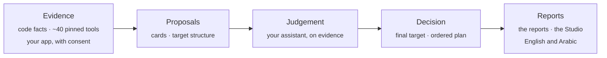

<p align="center">
  <picture>
    <source media="(prefers-color-scheme: dark)" srcset="docs/assets/brand/banner-dark.webp">
    
  </picture>
</p>

<p align="center">
  <b>The engineering review your AI-built software never had.</b><br>
  Evidence for every finding, the architecture it should reach, and fixes that prove themselves, in one command.
</p>

<p align="center">
  <a href="CHANGELOG.md"></a>
  
  
  <a href="LICENSE"></a>
  
</p>

<p align="center">
  <b>English</b> · <a href="README.ar.md">العربية</a> ·
  <a href="docs/GUIDE.md">Guide</a> ·
  <a href="docs/REFERENCE.md">Reference</a> ·
  <a href="CHANGELOG.md">Changelog</a> ·
  <a href="ROADMAP.md">Roadmap</a>
</p>

<p align="center">
  <picture>
    <source media="(prefers-color-scheme: dark)" srcset="docs/assets/screens/en/overview-dark.webp">
    
  </picture>
</p>

---

## Why EAOS

Software built quickly, often with an AI assistant, works, until nobody can say how it is built, what it touches, or
what a change will break. A serious engineering review takes weeks of senior time and usually ends as an opinion nobody
can verify, or a plan nobody can start.

EAOS is a software engineering firm in one command. Pinned open-source tools are its specialists; your own AI assistant
(Claude Code or Codex) is its senior engineer. One rule holds throughout: **no finding without evidence, no task without
an acceptance check, and no change bigger than the problem deserves.**

## What it does

<table>
  <tr>
    <td width="50%" valign="top">
      <h3>🔍 Check</h3>
      About forty pinned open-source tools and your app, run in an isolated copy, produce one set of facts: structure,
      complexity, duplication, dead code, security, dependencies, screens and speed. The system is read as layers: what
      ships to the browser, every endpoint's guard, the database's rules, where the business rules live, and the tests.
      Findings two engines agree on become cards; the rest are judged on their evidence.
    </td>
    <td width="50%" valign="top">
      <h3>👥 Try it as its users</h3>
      Simulated users, each with a role and a goal, drive your running app in an isolated copy: they pursue their goals,
      hand work to one another and write to a support desk. Each difficulty is met again by a fresh user and ruled on
      by a strict judge; a confirmed one becomes a fix card with its steps to reproduce and its pictures.
    </td>
  </tr>
  <tr>
    <td width="50%" valign="top">
      <h3>🧭 Plan</h3>
      The professional shape your project should reach: every component kept, restructured, merged, built or removed,
      with the reason, and whether to repair or rebuild. Then an ordered plan of small cards, each with its evidence,
      blast radius, acceptance command and rollback.
    </td>
    <td width="50%" valign="top">
      <h3>🛠️ Fix</h3>
      Your assistant writes the fixes in batches; EAOS checks every change: the problem is gone, the tests, the screens
      and their words still pass, no new weakness, duplication or layer break came in. What passes reaches you as a
      branch. You decide.
    </td>
  </tr>
</table>

## Three journeys

| Journey | You start with | You end with |
|---|---|---|
| **Repair** | A project that works on the surface | A check, a target structure, a plan, and fixes as branches you accept or throw away |
| **Build from a plan** | A PRD, notes, a PDF or Word file, or pictures of the screens | A project built card by card through the same gates, tidy from the first day ([how](docs/BUILD-FROM-PLAN.md)) |
| **Add a feature** | A checked project and a feature in your words | The feature planned against what the project already is, built as one batch without breaking what exists |

All three are proved end to end with a real assistant on this version ([`docs/METRICS.md`](docs/METRICS.md)).

## Quick start

**1. Install** (once). From inside your project folder:

```bash
curl -fsSL https://raw.githubusercontent.com/eom1417/engineering-audit-os/main/install.sh | bash
```

It installs EAOS and its tools at pinned versions, adds EAOS to **Claude Code** and **Codex**, and opens the Studio.

**2. Ask your assistant**, in your own words:

> Check my project with EAOS and fix its problems

Or type `/eaos` alone (in Codex: `$eaos`) for a menu of what fits your project now, the recommended step first.

**3. Follow it in the Studio.** Every stage as it runs, every finding with its evidence, and every decision that waits
for you. When the fixes are ready, they are a branch in your project: take it in, or throw it away.

> [!TIP]
> New to the terminal or to EAOS? The step-by-step **[Guide](docs/GUIDE.md)** shows what you should see at each step
> and what to do when something goes wrong.

## Commands at a glance

Everything the Studio does is also reachable from the terminal and from your assistant (MCP). The few commands most
people need:

```bash
eaos start                                # check this project (asks once about the assistant and running your app)
eaos check --path security code           # check only some paths (see below)
eaos check --path complete experience     # the complete check, plus one simulated user doing the main task
eaos status                               # where the project stands; `eaos next` says the next step
eaos problems --severity high             # the cards, filtered as in the Studio; `eaos problem <id>` shows one whole
eaos fix --group area=security            # fix a batch in an isolated copy, after a preview; or `eaos fix <id> <id>`
eaos accept                               # take the waiting branch of fixes; `eaos undo` throws it away
eaos studio                               # open the Studio of this project
```

Every command and option: [`docs/REFERENCE.md`](docs/REFERENCE.md), or `eaos <command> --help`.

## How a check works



A check is 40 declared stages in a fixed order: **evidence first, then the decision, then the plan, and the reports
last.** Without an AI assistant (`--assistant none`) it runs the same way and the rules decide alone. A stage that did
not run says why, a tool that failed is named, and `--again-from` goes on from one stage, keeping the rest.

**Check paths.** The complete check is the default; `--path` picks one or more:

| Path | What it looks at |
|---|---|
| `complete` | Every path together: the whole check |
| `code` | Structure and layers, cycles and coupling, complexity, duplication, dead code, the tests, how easily it grows |
| `security` | Exposed secrets, vulnerabilities, dependencies and their licences, dangerous settings, access gaps |
| `look` | The app's screens, their accessibility and speed, the design review, users' journeys |
| `speed` | The app under load, the cost of each entry at 1000 times the use, the hot paths, production readiness |
| `layers` | The boundaries tried on an isolated copy: secrets in the production build, the data rules as different users, the endpoints with two test accounts. Adds up to 15 minutes |
| `experience` | Simulated users. Alone: several people with their data, hand-offs and a support desk, up to an hour. Beside `complete`: one person doing the main task, up to 5 minutes and 12 light calls. Off unless chosen. Journeys it saved are replayed without AI in every full check |

**Model tiers.** Each AI stage asks on the tier it needs: a card's first triage and the translation on the light tier
(Claude Code's haiku, Codex's low effort), the plan's order and the visual review on the standard one (sonnet, medium),
the target structure, the fix review and every judge on the deep one (your own model, Codex's high effort). **A cheaper
model never closes anything alone:** setting a card aside, or calling a gap no gap or a screen clean, is asked again
on the deep tier. `--mode speed` runs several assistants at once and moves the standard stages to light.

**Logic-flaw hunting.** An optional deep check after a check, `eaos logic-flaws <project> --out <report folder>`: your
assistant reads each workflow for the flaws no rule can name (a skipped step, a race, a negative amount, the wrong
check). It says its time and cost before it starts; every flaw must cite a real line, survive a critic, and is triaged
like any card.

## What a check uses

Most of a check is EAOS's own analyzers, which use none of your assistant. The judging stages ask your assistant: on a
subscription they count against your plan, on an API key they cost money, and `eaos usage` shows the spend. Measured
with Claude Code ([`docs/METRICS.md`](docs/METRICS.md)); the dollars are the cost the assistant reports for its calls:

| Run (on 0.0.83 unless said) | Time | Cost |
|---|---|---|
| A complete check of a small Flask app | 738 s | $1.02 |
| One card on it fixed and handed over as a branch | 118 s | $0.36 |
| A feature added to it: a link on the navigation every page shows | 120 s | $0.43 |
| A new project built from a PRD to its first milestone's proof gate | 338 s | $0.91 |
| Simulated users on a sign-in app, the whole simulation (142 assistant calls) | — | $6.37 |
| A full check of EAOS's own repository, its app run (on 0.0.81) | 3,474 s | $9.09 |

The cost grows with the size of the project, the number of cards and the size of a fix batch. If a limit runs out
mid-way, nothing is lost: the work goes on from where it stopped, with the same assistant or another.

## The Studio

The Studio is EAOS's interface in your browser: shipped inside the package, served on this computer only, no internet
needed, in English and Arabic, light and dark, on a computer and on a phone.

<table>
  <tr>
    <td width="50%"></td>
    <td width="50%"></td>
  </tr>
  <tr>
    <td><b>Live check.</b> Every stage as it runs, the tools of each, what it produced, and "redo from here".</td>
    <td><b>Problems.</b> Every card with its evidence, down to the line, ready to fix in one batch.</td>
  </tr>
  <tr>
    <td colspan="2"></td>
  </tr>
  <tr>
    <td colspan="2"><b>The system map.</b> Regions, components and their links, today, during the change and at the target.</td>
  </tr>
</table>

<p align="center">
  
  
  
</p>

<p align="center"><sub>Pictured: a real check of
<a href="https://github.com/gothinkster/node-express-realworld-example-app">RealWorld Conduit</a>, an open-source
Node.js and TypeScript example app (MIT).</sub></p>

## What you receive

Everything lands in one folder, `~/EAOS/<your project>/`:

| | |
|---|---|
| `REPORT.html` | The report for people, in plain words: summary, gaps and risks, structure, plan and progress |
| `technical/START-HERE.md` | The first page: what was found, and what EAOS fixes alone |
| `technical/CURRENT-STATE.md` | What the program is today: features, data, measured risk |
| `technical/TARGET-STATE.md` | The same features on a structure fit for a product, with its infrastructure |
| `technical/GAP-AND-STRATEGY.md` | The distance, component by component, and the order to close it |
| `technical/EXECUTION-PLAN.md` | Milestones, sections and the first cards a team starts with |
| `technical/TARGET-ARCHITECTURE.md` | The structure the evidence argues for, and who decided each part |
| `technical/PLAN/` | Every card, one file each, and the plan's order |
| `technical/EXPERIENCE.md` | When users were simulated: who tried the app, what each reached, the confirmed difficulties |
| `technical/i18n/en/` · `technical/i18n/ar/` | Every document, whole, in English and in Arabic |
| `fixes/` · `HANDOVER.md` | Every batch of fixes and its branch · where the work stopped, for the next assistant |

Every card stands alone:

```text
TASK-001  7 functions are one function copied whole, up to identifier names
├─ evidence     the duplicate cluster, its lines, and the code itself
├─ blast radius files, importers, flows and the tests that cover them
├─ options      smallest change → restructuring → do nothing, each with its cost
├─ acceptance   a command that re-checks the problem itself
└─ rollback     how to take one step back
```

## Trust by design

EAOS treats your project as untrusted input, and your decisions as final.

- **Your code does not change** until you accept a branch. Fixes are built in an isolated copy.
- **Your app runs only with your consent**, in a separate copy on this computer, without your secrets or your real
  database. Simulated users drive only that copy.
- **Nothing unmeasured passes.** A stage that did not run, or a tool that failed, is said, never read as clean.
- **No feature is removed to hide a problem.** A fix that does is refused.
- **Instructions written inside your project, or shown by your app, are never followed**; they are data.

## The toolchain

EAOS orchestrates rather than rebuilds: about forty open-source tools and free design libraries, each at a pinned
version with its checksum and licence ([`eaos/data/toolchain.json`](eaos/data/toolchain.json),
[`THIRD_PARTY_NOTICES.md`](THIRD_PARTY_NOTICES.md)).

| Area | Tools |
|---|---|
| Structure and understanding | CodeGraph · GitNexus · Enola · Reforge · ast-grep · dependency-cruiser · react-docgen · CodeCharta · Emerge |
| Complexity, duplication, dead code | Lizard · jscpd · scc · knip, beside EAOS's own counts |
| Security and dependencies | Semgrep and its rules · Bandit · Gitleaks · CodeQL¹ · OSV-Scanner · Syft · Trivy · Checkov |
| Contracts and data | Spectral · oasdiff · SQLFluff · Schemathesis · the Supabase CLI's advisors · pgTAP |
| Your running app | Playwright · rrweb · Lighthouse · axe-core · css-analyzer · pytest · k6 · Mailpit (catches the app's e-mail) |
| Automatic changes | jscodeshift, beside EAOS's own move tool |
| Design (the look of a build or a redesign) | UI UX Pro Max · awesome-design-md · tweakcn themes · Anthropic's frontend-design; a built app gets shadcn/ui and Fontsource |

<sub>¹ CodeQL runs only on open-source projects hosted publicly on GitHub, as its terms allow. A pinned Java runtime
(Temurin) runs the tools that need one.</sub>

## Documentation

| | |
|---|---|
| [Guide](docs/GUIDE.md) · [دليل](docs/GUIDE.ar.md) | From nothing to your first fix, step by step |
| [Build from a plan](docs/BUILD-FROM-PLAN.md) · [عربي](docs/BUILD-FROM-PLAN.ar.md) | A new project from its plan, with the best structure; a feature added to a checked one |
| [North star](docs/NORTH-STAR.md) · [عربي](docs/NORTH-STAR.ar.md) | What EAOS is for, and the principles it never breaks |
| [AI in the pipeline](docs/AI-IN-THE-PIPELINE.md) | Where your assistant decides, and how its decisions are checked |
| [MCP tools](docs/MCP.md) | The tools EAOS gives your AI assistant |
| [Reference](docs/REFERENCE.md) | Every command and option |

## Contributing

Issues and pull requests are welcome: read [`CONTRIBUTING.md`](CONTRIBUTING.md) first. To report a vulnerability,
follow [`SECURITY.md`](SECURITY.md). Everyone taking part follows the [Code of Conduct](CODE_OF_CONDUCT.md). A
development copy: `bash tools/dev_setup.sh` builds the environment and installs every tool, pinned.

## License

[MIT](LICENSE). The tools EAOS runs keep their own licences, listed in [`THIRD_PARTY_NOTICES.md`](THIRD_PARTY_NOTICES.md).

<p align="center"><sub>Built with EAOS, checked by EAOS.</sub></p>
