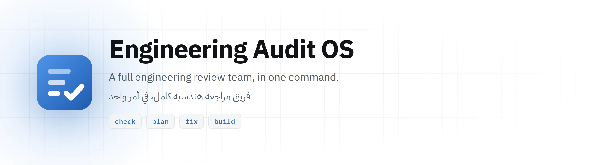
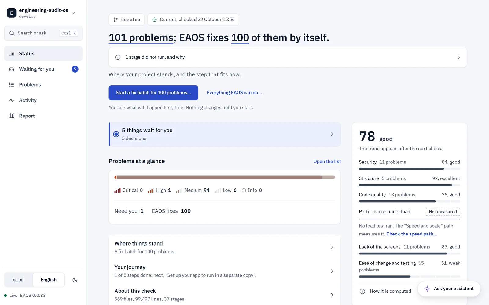
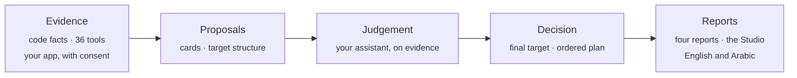
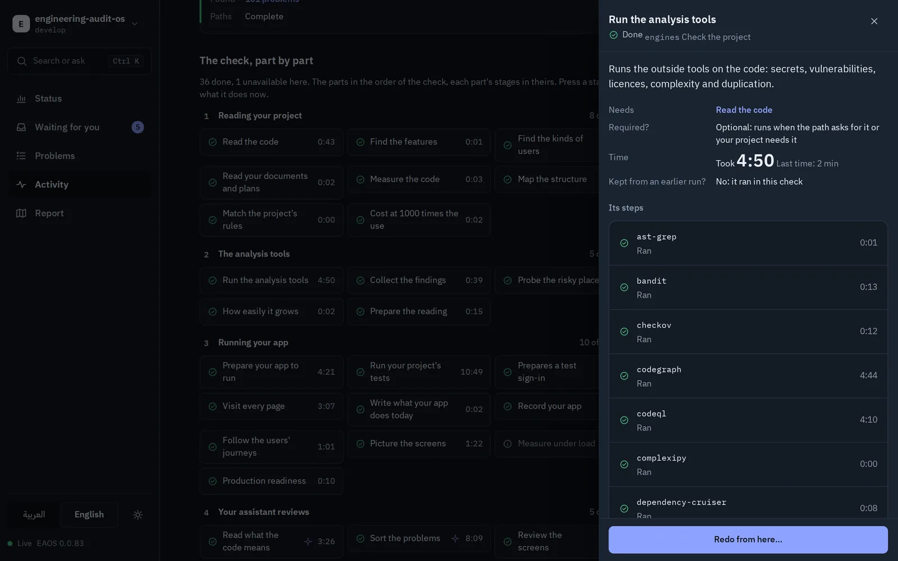
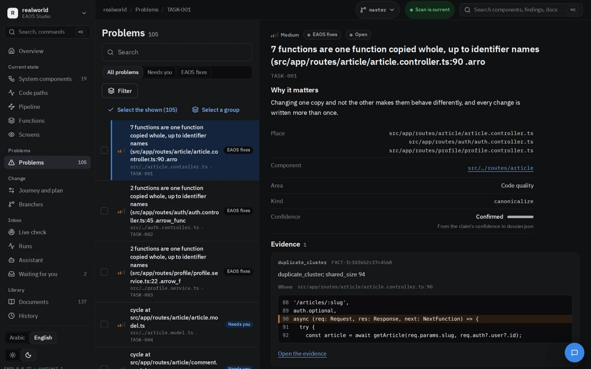
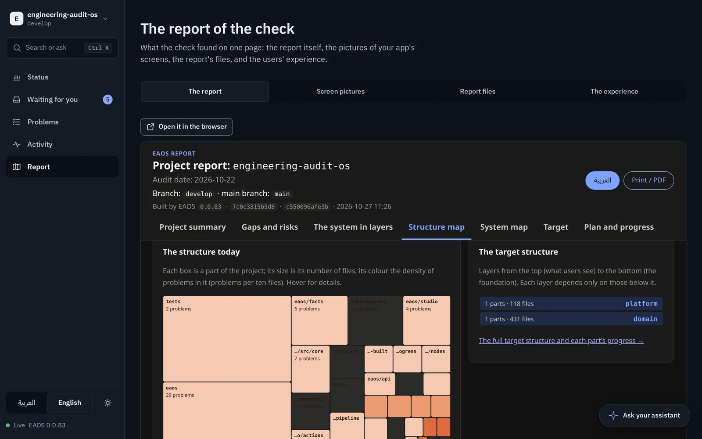
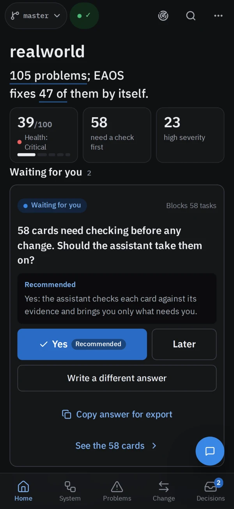
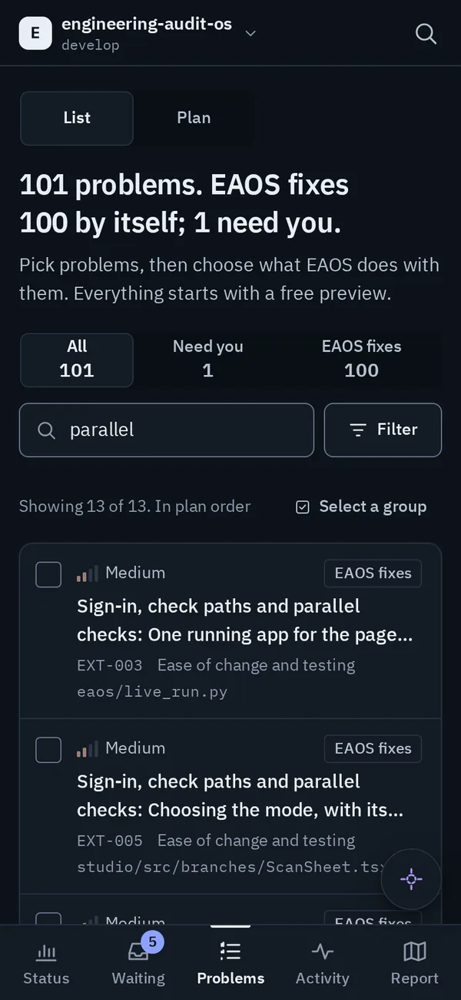
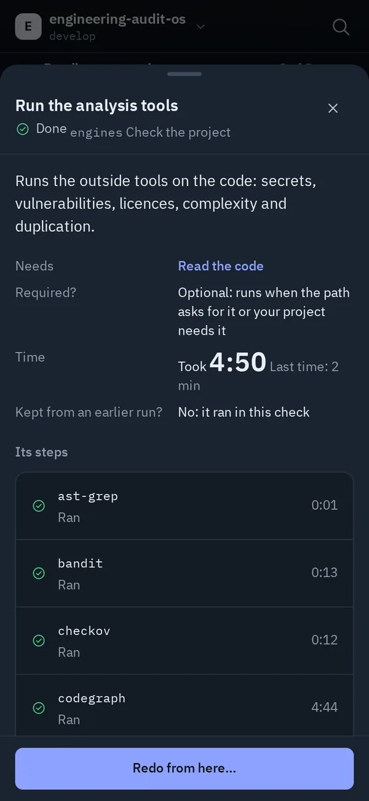

<p align="center">
  <picture>
    <source media="(prefers-color-scheme: dark)" srcset="docs/assets/brand/banner-dark.webp">
    
  </picture>
</p>

<p align="center">
  <b>The engineering review your AI-built software never had.</b><br>
  Evidence for every finding, the architecture it should reach, and fixes that prove themselves, in one command.
</p>

<p align="center">
  <a href="CHANGELOG.md"></a>
  
  
  <a href="LICENSE"></a>
  
</p>

<p align="center">
  <b>English</b> · <a href="README.ar.md">العربية</a> ·
  <a href="docs/GUIDE.md">Guide</a> ·
  <a href="docs/REFERENCE.md">Reference</a> ·
  <a href="CHANGELOG.md">Changelog</a> ·
  <a href="ROADMAP.md">Roadmap</a>
</p>

<p align="center">
  <picture>
    <source media="(prefers-color-scheme: dark)" srcset="docs/assets/screens/en/overview-dark.webp">
    
  </picture>
</p>

---

## Why EAOS

Software built quickly, often with an AI assistant, works, until nobody can say how it is built, what it touches,
or what a change will break. A serious engineering review takes weeks of senior time and usually ends as an opinion
nobody can verify, or a plan nobody can start.

EAOS replaces both with one rule: **no finding without evidence, no task without an acceptance check, and no change
bigger than the problem deserves.** It reads your project the way an architect, a code reviewer, a security engineer
and a tech lead would, together, and every conclusion links back to the facts behind it.

## What it does

<table>
  <tr>
    <td width="50%" valign="top">
      <h3>🔍 Check</h3>
      Thirty-six pinned open-source analyzers and your app, run in an isolated copy, produce one set of facts:
      structure, complexity, duplication, dead code, security, dependencies, screens and speed. Findings that two
      engines agree on become cards; the rest are judged on their evidence.
    </td>
    <td width="50%" valign="top">
      <h3>🧭 Plan</h3>
      The professional shape your project should reach: every component kept, restructured, merged, built or removed,
      with the reason. Then an ordered plan of small cards, each with its evidence, blast radius, acceptance command
      and rollback.
    </td>
  </tr>
  <tr>
    <td width="50%" valign="top">
      <h3>🛠️ Fix</h3>
      Your assistant writes the fixes in batches; EAOS checks every change: the problem is gone, the tests and the app
      still pass, no new weakness, duplication or layer break came in. What passes reaches you as a branch. You decide.
    </td>
    <td width="50%" valign="top">
      <h3>🏗️ Build</h3>
      Start from a plan instead of code: a PRD, notes, a PDF or Word file, or pictures of the screens. EAOS draws the
      structure, the look and the whole build plan, then builds it card by card through the same gates. A checked
      project grows the same way: a feature planned against what it already is, built as a batch.
    </td>
  </tr>
</table>

## Quick start

**1. Install** (once). From inside your project folder:

```bash
curl -fsSL https://raw.githubusercontent.com/eom1417/engineering-audit-os/main/install.sh | bash
```

It installs EAOS and its tools at pinned versions, adds EAOS to **Claude Code** and **Codex**, and opens the Studio.

**2. Ask your assistant**, in your own words:

> Check my project with EAOS and fix its problems

Or type `/eaos` alone (in Codex: `$eaos`) for a menu of what fits your project now, the recommended step first.

**3. Follow it in the Studio.** Every stage as it runs, every finding with its evidence, and every decision that waits
for you. When the fixes are ready, they are a branch in your project: take it in, or throw it away.

> [!TIP]
> New to the terminal or to EAOS? The step-by-step **[Guide](docs/GUIDE.md)** shows what you should see at each step
> and what to do when something goes wrong.

## How a check works



A check is 35 declared stages in a fixed order: **evidence first, then the decision, then the plan, and the reports
last.** Without an AI assistant it runs the same way and the rules decide alone. A stage that did not run says why, a
tool that failed is named, and when one stage needs redoing the check **goes on from that stage**, keeping the rest:
never a whole new check for one stage.

## What a check uses

Most of a check is EAOS's own analyzers, which use none of your assistant. Your assistant does the judging stages, and
those count against its plan. Measured on EAOS itself (593 files, about 7,400 functions, Claude Code with Opus), the
whole check took about an hour of model time, worth about **US$22 at API list prices**:

| Stage | Share |
|---|---|
| Sorting the cards against their evidence | about 45% |
| Reviewing the recorded screens | about 18% |
| The ideal target structure | about 17% |
| Planning, ordering, setup and the project's meaning | about 15% |
| Translating the reports (the smallest model, without thinking) | about 3% |

It grows with the size of the project and the number of cards. **A fix batch uses much more**: your assistant edits card
by card, and a batch of 70 cards can take several hours. On a five-hour plan, start a large batch in a fresh window. If
a limit runs out mid-way, nothing is lost: the work goes on from where it stopped, with the same assistant or another.

## The Studio

The Studio is EAOS's interface in your browser: shipped inside the package, no internet needed, in English and Arabic,
light and dark, on a computer and on a phone.

<table>
  <tr>
    <td width="50%"></td>
    <td width="50%"></td>
  </tr>
  <tr>
    <td><b>Live check.</b> Every stage as it runs, the tools of each, what it produced, and "redo from here".</td>
    <td><b>Problems.</b> Every card with its evidence, down to the line, ready to fix in one batch.</td>
  </tr>
  <tr>
    <td colspan="2"></td>
  </tr>
  <tr>
    <td colspan="2"><b>The system map.</b> Regions, components and their links, today, during the change and at the target.</td>
  </tr>
</table>

<p align="center">
  
  
  
</p>

<p align="center"><sub>Pictured: a real check of
<a href="https://github.com/gothinkster/node-express-realworld-example-app">RealWorld Conduit</a>, an open-source
Node.js and TypeScript example app (MIT).</sub></p>

## What you receive

Everything lands in one folder, `~/EAOS/<your project>/`:

| | |
|---|---|
| `REPORT.html` | The report for people, in plain words |
| `technical/CURRENT-STATE.md` | What the program is today: features, data, structure, measured risk |
| `technical/TARGET-STATE.md` | The same program on a structure fit for a product |
| `technical/GAP-AND-STRATEGY.md` | The distance between the two, and the strategy that closes it |
| `technical/EXECUTION-PLAN.md` | The ordered cards, milestone by milestone |
| `technical/i18n/en/` · `technical/i18n/ar/` | Every document, whole, in English and in Arabic |

Every card stands alone:

```text
TASK-001  7 functions are one function copied whole, up to identifier names
├─ evidence     the duplicate cluster, its lines, and the code itself
├─ blast radius files, importers, flows and the tests that cover them
├─ options      smallest change → restructuring → do nothing, each with its cost
├─ acceptance   a command that re-checks the problem itself
└─ rollback     how to take one step back
```

## Trust by design

EAOS treats your project as untrusted input, and your decisions as final.

- **Your code does not change** until you accept a branch. Fixes are built in an isolated copy.
- **Your app runs only with your consent**, in a separate copy, without your secrets or your real database.
- **Nothing unmeasured passes.** A stage that did not run, or a tool that failed, is said, never read as clean.
- **No feature is removed to hide a problem.** A fix that does is refused.
- **Instructions written inside your project are never followed**; they are data.

## The toolchain

EAOS orchestrates rather than rebuilds: 36 open-source tools and free design libraries, each at a pinned version with its checksum and licence
([`upstreams/toolchain.json`](upstreams/toolchain.json), [`THIRD_PARTY_NOTICES.md`](THIRD_PARTY_NOTICES.md)).

| Area | Tools |
|---|---|
| Structure and understanding | CodeGraph · GitNexus · Enola · Reforge · ast-grep · dependency-cruiser · react-docgen · CodeCharta · Emerge |
| Complexity, duplication, dead code | Lizard · complexipy · jscpd · scc · vulture · knip |
| Security and dependencies | Semgrep · Bandit · Gitleaks · CodeQL¹ · OSV-Scanner · Syft · Trivy · Checkov |
| Contracts and data | Spectral · oasdiff · SQLFluff |
| Your running app | Playwright · rrweb · Lighthouse · axe-core · css-analyzer · pytest · k6 |
| Automatic changes | jscodeshift |
| Design (the look of a build or a redesign) | UI UX Pro Max · awesome-design-md · tweakcn themes · Anthropic's frontend-design · shadcn/ui · Fontsource |

<sub>¹ CodeQL runs only on open-source projects hosted publicly on GitHub, as its terms allow.</sub>

## Documentation

| | |
|---|---|
| [Guide](docs/GUIDE.md) · [دليل](docs/GUIDE.ar.md) | From nothing to your first fix, step by step |
| [Build from a plan](docs/BUILD-FROM-PLAN.md) · [عربي](docs/BUILD-FROM-PLAN.ar.md) | A new project from its plan, with the best structure; a feature added to a checked one |
| [AI in the pipeline](docs/AI-IN-THE-PIPELINE.md) | Where your assistant decides, and how its decisions are checked |
| [MCP tools](docs/MCP.md) | The tools EAOS gives your AI assistant |
| [Reference](docs/REFERENCE.md) | Every command and option |

## Contributing

Issues and pull requests are welcome: read [`CONTRIBUTING.md`](CONTRIBUTING.md) first. To report a vulnerability,
follow [`SECURITY.md`](SECURITY.md). Everyone taking part follows the [Code of Conduct](CODE_OF_CONDUCT.md).

```bash
bash tools/dev_setup.sh                                             # the environment and every tool, pinned
.venv/bin/python -m unittest discover -s tests -q && .venv/bin/python tools/validate.py
(cd console && npm run build)                                       # the Studio: built into eaos/data/studio, within its budgets
```

## License

[MIT](LICENSE). The tools EAOS runs keep their own licences, listed in [`THIRD_PARTY_NOTICES.md`](THIRD_PARTY_NOTICES.md).

<p align="center"><sub>Built with EAOS, checked by EAOS.</sub></p>
