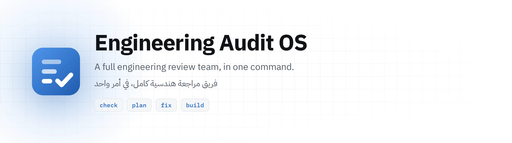
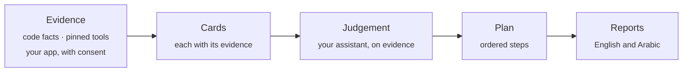

<p align="center">
  <picture>
    <source media="(prefers-color-scheme: dark)" srcset="docs/assets/brand/banner-dark.webp">
    
  </picture>
</p>

<p align="center">
  <b>The engineering review your AI-built software never had.</b><br>
  Evidence for every finding, an ordered plan, and fixes that prove themselves, in one command.
</p>

<p align="center">
  <a href="CHANGELOG.md"></a>
  
  
  <a href="LICENSE"></a>
  
</p>

<p align="center">
  <b>English</b> · <a href="README.ar.md">العربية</a> ·
  <a href="docs/GUIDE.md">Guide</a> ·
  <a href="docs/REFERENCE.md">Reference</a> ·
  <a href="CHANGELOG.md">Changelog</a> ·
  <a href="ROADMAP.md">Roadmap</a>
</p>

---

> **Direction (2026-11):** EAOS is being re-centred on one goal: running a full structural clean-up round on a
> beginner's or vibe-coded project, behaviour proved unchanged, until it is a clean product that can ship
> ([North star](docs/NORTH-STAR.md), [Roadmap](ROADMAP.md)). What this page describes is what EAOS does today.

## Why EAOS

Software built quickly, often with an AI assistant, works, until nobody can say how it is built, what it touches, or
what a change will break. A serious engineering review takes weeks of senior time and usually ends as an opinion nobody
can verify, or a plan nobody can start.

EAOS is a software engineering firm in one command. Pinned open-source tools are its specialists; your own AI assistant
(Claude Code or Codex) is its senior engineer. One rule holds throughout: **no finding without evidence, no task without
an acceptance check, and no change bigger than the problem deserves.**

## What it does

<table>
  <tr>
    <td width="50%" valign="top">
      <h3>🔍 Check</h3>
      About twenty pinned open-source tools and EAOS's own analyzers, with your app run in an isolated copy when you
      agree, produce one set of facts: structure, complexity, duplication, dead code, security, screens. The system is
      read as layers: what ships to the browser, every endpoint's guard, the database's rules, where the business rules
      live, and the tests. Each finding becomes a card with its evidence, judged by your assistant.
    </td>
    <td width="50%" valign="top">
      <h3>🛠️ Fix</h3>
      An ordered plan of small cards, each with its evidence, blast radius, acceptance command and rollback. Your
      assistant writes the fixes in batches; EAOS checks every change: the problem is gone, the tests, the screens and
      their words still pass, no new weakness, duplication or layer break came in. What passes reaches you as a branch.
      You decide.
    </td>
  </tr>
</table>

## Quick start

**1. Install** (once). From inside your project folder:

```bash
curl -fsSL https://raw.githubusercontent.com/eom1417/engineering-audit-os/main/install.sh | bash
```

It installs EAOS and its tools at pinned versions, and adds EAOS to **Claude Code** and **Codex**.

**2. Ask your assistant**, in your own words:

> Check my project with EAOS and fix its problems

Or type `/eaos` alone (in Codex: `$eaos`) for a menu of what fits your project now, the recommended step first.

**3. Decide.** Your assistant explains what the check found, with its evidence, and asks you only what is yours to
decide. When the fixes are ready, they are a branch in your project: take it in, or throw it away.

> [!TIP]
> New to the terminal or to EAOS? The step-by-step **[Guide](docs/GUIDE.md)** shows what you should see at each step
> and what to do when something goes wrong.

## Commands at a glance

Everything your assistant does with EAOS (MCP) is also reachable from the terminal. The few commands most people need:

```bash
eaos start                                # check this project (asks once about the assistant and running your app)
eaos check --path security code           # check only some paths (see below)
eaos status                               # where the project stands; `eaos next` says the next step
eaos problems --severity high             # the cards, filtered; `eaos problem <id>` shows one whole
eaos fix --group area=security            # fix a batch in an isolated copy, after a preview; or `eaos fix <id> <id>`
eaos accept                               # take the waiting branch of fixes; `eaos undo` throws it away
```

Every command and option: [`docs/REFERENCE.md`](docs/REFERENCE.md), or `eaos <command> --help`.

## How a check works



A check is 27 declared stages in a fixed order: **evidence first, then the cards and their judgement, then the plan,
and the reports last.** Without an AI assistant (`--assistant none`) it runs the same way and the rules decide alone. A
stage that did not run says why, a tool that failed is named, and `--again-from` goes on from one stage, keeping the
rest.

**Check paths.** The complete check is the default; `--path` picks one or more:

| Path | What it looks at |
|---|---|
| `complete` | Every path together: the whole check |
| `code` | Structure and layers, cycles and coupling, complexity, duplication, dead code, the tests |
| `security` | Exposed secrets, vulnerable code, real data written in the code, layer boundaries |
| `look` | The app's screens, their accessibility and speed, users' journeys |
| `speed` | Work the code does more than once (repeated calls, a query in a loop) |

**Model tiers.** Each AI stage asks on the tier it needs: a card's first triage and the translation on the light tier
(Claude Code's haiku, Codex's low effort), the plan's order on the standard one (sonnet, medium), the fix review and
every other AI step on the deep one (your own model, Codex's high effort). **A cheaper model never closes anything
alone:** setting a card aside is asked again on the deep tier. `--mode speed` runs several assistants at once and moves
the standard stages to light.

## What a check uses

Most of a check is EAOS's own analyzers, which use none of your assistant. The judging stages ask your assistant: on a
subscription they count against your plan, on an API key they cost money, and `eaos usage` shows the spend. Measured
with Claude Code ([`docs/METRICS.md`](docs/METRICS.md)); the dollars are the cost the assistant reports for its calls:

| Run (on 0.0.83, which ran more stages than a check runs now) | Time | Cost |
|---|---|---|
| A complete check of a small Flask app | 738 s | $1.02 |
| One card on it fixed and handed over as a branch | 118 s | $0.36 |

The cost grows with the size of the project, the number of cards and the size of a fix batch. If a limit runs out
mid-way, nothing is lost: the work goes on from where it stopped, with the same assistant or another.

## What you receive

Everything lands in one folder, `~/EAOS/<your project>/`:

| | |
|---|---|
| `technical/START-HERE.md` | The first page: what was found, and what EAOS fixes alone |
| `technical/CURRENT-STATE.md` | What the program is today: features, data, measured risk |
| `technical/TARGET-STATE.md` | The same features on a structure fit for a product, with its infrastructure |
| `technical/GAP-AND-STRATEGY.md` | The distance, component by component, and the order to close it |
| `technical/EXECUTION-PLAN.md` | Milestones, sections and the first cards a team starts with |
| `technical/PLAN/` | Every card, one file each, and the plan's order |
| `technical/i18n/en/` · `technical/i18n/ar/` | Every document, whole, in English and in Arabic |
| `fixes/` · `HANDOVER.md` | Every batch of fixes and its branch · where the work stopped, for the next assistant |

Every card stands alone:

```text
TASK-001  7 functions are one function copied whole, up to identifier names
├─ evidence     the duplicate cluster, its lines, and the code itself
├─ blast radius files, importers, flows and the tests that cover them
├─ options      smallest change → restructuring → do nothing, each with its cost
├─ acceptance   a command that re-checks the problem itself
└─ rollback     how to take one step back
```

## Trust by design

EAOS treats your project as untrusted input, and your decisions as final.

- **Your code does not change** until you accept a branch. Fixes are built in an isolated copy.
- **Your app runs only with your consent**, in a separate copy on this computer, without your secrets or your real
  database.
- **Nothing unmeasured passes.** A stage that did not run, or a tool that failed, is said, never read as clean.
- **No feature is removed to hide a problem.** A fix that does is refused.
- **Instructions written inside your project, or shown by your app, are never followed**; they are data.

## The toolchain

EAOS orchestrates rather than rebuilds: about twenty open-source tools, each at a pinned version with its checksum
and licence ([`eaos/data/toolchain.json`](eaos/data/toolchain.json), [`THIRD_PARTY_NOTICES.md`](THIRD_PARTY_NOTICES.md)).

| Area | Tools |
|---|---|
| Structure and understanding | ast-grep · dependency-cruiser, beside EAOS's own graph and code map |
| Complexity, duplication, dead code | Lizard · jscpd · knip, beside EAOS's own counts |
| Security | Semgrep and its rules · Gitleaks · Presidio (real data written in the code) |
| Your running app | Playwright · rrweb · Lighthouse · axe-core · pytest · Mailpit (catches the app's e-mail) |
| Automatic changes | jscodeshift, beside EAOS's own move tool |

## Documentation

| | |
|---|---|
| [Guide](docs/GUIDE.md) · [دليل](docs/GUIDE.ar.md) | From nothing to your first fix, step by step |
| [North star](docs/NORTH-STAR.md) · [عربي](docs/NORTH-STAR.ar.md) | What EAOS is for, and the principles it never breaks |
| [AI in the pipeline](docs/AI-IN-THE-PIPELINE.md) | Where your assistant decides, and how its decisions are checked |
| [MCP tools](docs/MCP.md) | The tools EAOS gives your AI assistant |
| [Reference](docs/REFERENCE.md) | Every command and option |

## Contributing

Issues and pull requests are welcome: read [`CONTRIBUTING.md`](CONTRIBUTING.md) first. To report a vulnerability,
follow [`SECURITY.md`](SECURITY.md). Everyone taking part follows the [Code of Conduct](CODE_OF_CONDUCT.md). A
development copy: `bash tools/dev_setup.sh` builds the environment and installs every tool, pinned.

## License

[MIT](LICENSE). The tools EAOS runs keep their own licences, listed in [`THIRD_PARTY_NOTICES.md`](THIRD_PARTY_NOTICES.md).

<p align="center"><sub>Built with EAOS, checked by EAOS.</sub></p>
