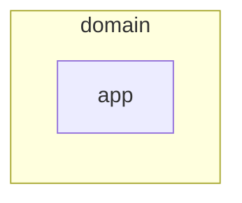

# Current state

## Summary

Decision asked for: accept this description as the baseline; no high item has
enough witnesses, so start with the stabilize milestone.

### The numbers that matter

- 6/6 files analysed (dossier.json → coverage)
- 1 features, of which 0 critical (features.json)
- 3 debt items, of which 0 high or critical (debt-register.json)

### The largest risks

- DEBT-001 (low, dead\_code): unreachable module `app/old_export.py`: no
  production entry point imports it
- DEBT-002 (low, dead\_code): unreachable module `app/old_mail.py`: no
  production entry point imports it
- DEBT-003 (low, dead\_code): unreachable module `app/old_report.py`: no
  production entry point imports it

## Evidence and inference

What the program does today, by its surfaces and the data each feature touches:

- cli:shop: أمر واحد، لا تلمس بيانات

Debt by category (debt-register.json): dead\_code 3

The most complex, most changed files (measurements.json):

- app/\_\_init\_\_.py: complexity 1, commits 1, fan-in 0
- app/main.py: complexity 1, commits 1, fan-in 0
- app/old\_export.py: complexity 1, commits 1, fan-in 0
- app/old\_mail.py: complexity 1, commits 1, fan-in 0
- app/old\_report.py: complexity 1, commits 1, fan-in 0

### C4

## Impact

Every high item in the register has a deterministic witness or two tools;
leaving one means a known risk ships in every release.

## Recommendation

Start with the stabilize milestone in EXECUTION-PLAN.md.

## Not examined

- unparsed source files: 0
- unresolved or ambiguous imports: 0
- invocation surfaces with no detector: 0 files
- runtime behaviour: no execution evidence in this run
- semantic review: not performed in this run (facts only)
- an experimental detector kept aside until it is measured precise:
  redundant\_work (2 results not shown: only 4 judged outputs (bar 5))

## Appendices

- `features.json`
- `measurements.json`
- `debt-register.json`
- `load-model.json`
- `facts/external.json`
