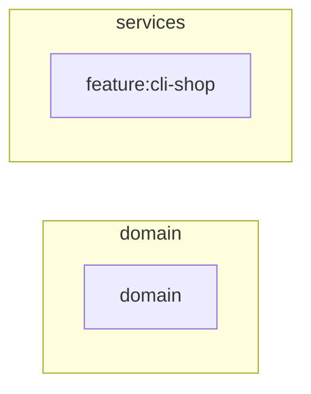

# Target state

## Summary

Decision asked for: adopt `python-cli` as a modular monolith, with the same
features.

### The numbers that matter

- 2 target components (target-architecture.json → target\_components)
- 1/1 features placed (target-architecture.json → target\_components → feature)
- 0 forbidden imports removed (target-architecture.json → forbidden\_edges)
- No assistant judged this target: the rules decided every part of it.
  (target-architecture.json → decided)

### The largest risks

- data: Introduce: Inputs and outputs in documented formats with versions. Why:
  A format change breaks scripts that call the tool.
- ci: Introduce: Tests on every push, on every supported Python. Why: A change
  breaks an older interpreter unseen.
- tests: Introduce: Unit tests plus approval tests of command output. Why:
  Output is the tool's interface.

## Evidence and inference

The largest components (names and responsibilities in TARGET-ARCHITECTURE.md):

- domain (domain): 6 files, 0 moving in
- feature:cli-shop (services): 0 files, 0 moving in

### C4

## Infrastructure

- ✅ configuration: —. the environment is read in 0 file(s)
- ⬜ data: —. typed schema source: none
- ⬜ ci: GitHub Actions + pre-commit. 0 CI step(s) in the repository
- ⬜ tests: pytest + ApprovalTests. 0 test file(s)
- ⬜ observability: —. 0 observability signal(s)
- ✅ secrets: —. 0 secret-class credential(s) committed

## Every aspect of the program: keep or improve

Your assistant's verdict on each aspect it judged, the rules' on the rest
(target-architecture.json → aspects).

- Structure and architecture: keep: already right, nothing changes. no import
  cycle, no breach of a declared layering and no module past the line limit (the
  rules)
- Sustainability indicators: improve. indicators above their target:
  minimal\_path (the rules)
- One home per repeated definition: keep: already right, nothing changes. no
  definition is repeated across files (the rules)
- Tests and coverage: improve. the project has no test file (the rules)
- Users' journeys through the app: not measured in this check. the app was not
  run in an isolated copy in this check, so no journey was walked (the rules)
- Speed under load: not measured in this check. QS-001: 100 users at the same
  time use every user-facing route (the rules)
- Resilience when a dependency fails: keep: already right, nothing changes. No
  external dependency a fault could hit was found in the code (the rules)
- Security: keep: already right, nothing changes. No route a security scan could
  request without a fixture (the rules)
- Observability in production: improve. No health route a load balancer or
  uptime check could call; No traces, metrics or error capture in the code (the
  rules)
- Screens and accessibility: not measured in this check. no screen was pictured
  in this check (the rules)
- Problems found in the code: improve. 3 open card(s) with their evidence (the
  rules)

## Recommendation

The decisions are MADR files in adr/, each with its options and the cost of
doing nothing.

## Not examined

- No service split is proposed: no quality scenario justifies one.

## Appendices

- [TARGET-ARCHITECTURE.md](TARGET-ARCHITECTURE.md)
- [adr/](adr/)
- [architecture/](architecture/)
